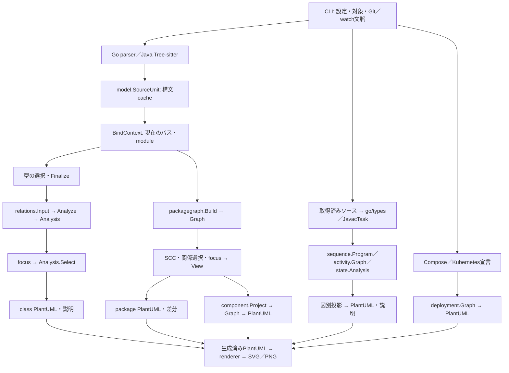

# 解析・共通モデル・図への投影

対象: [#82](https://github.com/Mino829/umlgen/issues/82)。新しい万能Node／Edgeや公開APIを作らず、既存の共通宣言モデルと図別モデルを使う。変更点は、クラス図の関係解析を上流で一度行い、focus・PlantUML・説明が同じ結果を消費する境界である。

## 調査結果とデータフロー

### 構文・宣言の共通部分

- [language.Parser](../internal/language/language.go)は両言語とも`*model.SourceUnit`を返す。JavaはTree-sitter、Goは標準`go/parser`を使い、構文エラー時はそのファイルを失敗として扱う。クラス図・package図ではプロジェクトをコンパイルしない。
- [model.SourceUnit](../internal/model/source.go)は言語、内容SHA-256、ファイル範囲、package節、ファイルごとのimport、型、構文上の診断を保持する。型0件のファイルも残る。AST・ソース本文は保存しない。`SourceSpan`は物理UTF-8バイト位置の半開区間で、行・byte列は1始まり。型・メンバーは開始ファイル／行が中心で、完全な宣言終端spanはまだない。
- [model.Type / Project](../internal/model/model.go)はGo・Java共通のクラス図向け宣言表現。型、入れ子、メンバー、型パラメーターのスコープ、import、親参照とその推定フラグを保持する。Goの自由関数・式・呼び出し・制御フローはこのモデルへ追加しない。
- Javaのfinalizeは安定順序を整える。Goは別ファイルのレシーバーメソッドを型宣言へ統合し、構文的メソッド集合の照合からinterface実装候補を加える。説明時のみ一致に使ったメソッドの位置も保持する。alias宣言は`model.Alias`として残し、クラスや参照先への展開と混同しない。

### 関係・投影・出力の変更

従来はfocus、クラス図生成、説明が、それぞれ型宣言から関係を再構築した。最後の表示対象だけで再解決すると、解析時の既知の参照先を隠した後に別のimportへ束縛し直す危険もあった。

採用した契約:

1. `relations.Input.Types`はinclude／package除外とfinalize後の**選択済み解析範囲**。`Known`は同じ実行で解析した、表示から除外された宣言を含む文脈である。未探索ファイルや外部依存を推測して補わない。
2. `relations.Analyze(input, details)`が一度だけ解決する。従来のクラス図resolverに合わせ、関係線は`Types`内だけで構築する。`Known`は図の外の既知参照と未解決を区別するためだけに使い、非表示宣言から線を追加したり、includeの名前解決規則を変更したりしない。
3. `relations.Analysis`が既存`model.Project`、選択済み関係、任意の根拠・診断をまとめる。独立したクラス用Node／Edgeモデルは増やさない。初期範囲の解決済み参照は詳細要求時だけ内部に保持する。
4. `focus.Apply / ApplyMany`はこのグラフをBFSし、`Analysis.Select`で表示宣言・辺を射影する。名前束縛をやり直さない。元の解析は変更しないため、必要なら呼び出し元が全体と複数の投影を保持できる。
5. 射影で隠れた既知の参照先は`outside-diagram`となる。既存の未解決診断は`unresolved`のまま。generic内の各参照、複数根拠、宣言位置を保ち、同じ参照の診断は重複排除する。Goの実装照合に使ったメソッドは親参照の追加証拠であり、隠れた親への別々の参照にはしない。
6. `plantuml.Generate`は供給された`Analysis.Project`と`Relations`だけを描く。ソース読取・型解決・実装推定は行わない。CLIの説明も同じ解析を関係種別で選ぶだけで、再解析しない。

`details=false`では根拠配列、参照診断、射影用の詳細参照記録を作らない。CLIは通常実行で説明用のソース本文・`Known`配列も作らない。focus／class diffは表示が`--no-relations`でも到達範囲を求めるためグラフが必要だが、それ以外の関係非表示では解析を省く。

既存の`relations.Build`は廃止し、軽量・詳細は同じ`Analyze`で指定する。focus、生成、説明、class diff、watch（同じclass実行経路）、直接呼出テスト、parser／cacheテスト、benchmarkを移行した。package graphの`AnalyzeWithResolver`は文脈付きの専用resolverを受け取る別用途であり、互換wrapperではない。package graphはクラス用のfocusを使わず、自分の`Graph / View`へ投影する。

### 変えない選択規則

- クラスfocusは継承／実装／フィールド／引数／戻り値の全5種類をたどる。`--relations`、`--no-relations`、メンバー／可視性の設定はBFSの辺を減らさない。入出方向、深さ、複数seed、曖昧な名前のエラーは従来どおり。
- packageは別規則である。依存元・関係種別を選択した後、focusより前のグラフでSCCを検出する。外部非表示やcycle-onlyで元の循環を再分類しない。`cycles off`は未検出であり、非循環を保証しない。
- 出力順序、既存alias、レイアウト、関係記法・多重度、goldenの期待値は変えない。focus後の再解決を廃止したため、隠れたネスト型と代替importがある場合も最初の束縛を保ち、別の型への偽の辺を作らない。この文脈喪失ケースは専用回帰で固定する。

## 意味・同一性・安定性の契約

| 領域 | 実際の識別子と安定性 | 限界 |
| --- | --- | --- |
| クラス型 | `Type.QualifiedName()` = package＋enclosing＋name。表示名／generic表記とは別 | 言語・物理root・module rootを含む普遍的IDではない。同じpackage名・型名を持つ複数Java rootや、同じmodule pathの複製を区別できない。クラス索引は同一完全名を統合／上書きし得る |
| クラスメソッド | 宣言配列、引数型を含む説明用signature、元位置 | 独立した永続symbol IDはない。overloadの証拠はsignature・位置で区別するが、任意の構造差分用IDとして流用しない |
| 型関係 | from／to／kind／label／multiplicityの組 | 同じ辺の根拠を別配列で保持する。辺数・根拠数・import宣言数は異なる。位置を辺IDへ混ぜない |
| package | `PackageID{Language, Context, Name}` | ContextはGoのmodule／root、Javaの解析source root。物理rootの移動や別snapshotではcallerによる文脈の対応付けが必要 |
| callable | backendが作る`context::selector`。selectorは完全名と引数型を含む | Goはpackage context、Javaはsource root。overloadを区別するが、ソースの移動やシグネチャ変更をまたぐ永続IDではない。重複宣言には診断がある |
| activity | 選択callable＋そのgraph内の整数node ID | 別graph／編集前後でのnode ID一致を保証しない |
| component | 明示boundary名、または文脈付きPackageID | 所有関係は設定で定義する。ソースだけから実行時サービスを推定しない |
| deployment | kind／namespace／nameと宣言出典 | manifestの宣言上の同一性で、稼働中の実体や到達性の証明ではない |

PlantUML aliasは出力時の局所名。クラスは安全化した完全名の衝突を決定的なsuffixで避け、package等も図別aliasを持つ。aliasはsymbol IDでもcache keyでもなく、表示対象の変化でsuffixが変わり得る。完全名衝突や曖昧なwildcardの入力に対し、列挙順によらない完全な意味解決を約束しない。

### 言語差と確実性

- Goのembeddingはメンバー昇格を伴う埋め込みであり、Javaのクラス継承ではない。既存のクラス図では共通`inheritance`辺へ投影するが、`Evidence.Language / OwnerKind`から説明を区別する。Javaのinterface拡張・明示implementsとも意味を混同しない。
- Goの暗黙実装は構文的照合で`Inferred=true`。コンパイラーによる実装証明ではなく、generic／type set／外部依存等の完全な判定を主張しない。多重度も型表記に基づく推定で、所有権や実行時個数ではない。
- クラスresolverは型文字列と選択宣言・importを使う。Goで統合された型のimportは完全なファイル別束縛ではなく、Java wildcardにもコンパイラー相当の曖昧性判定はない。classの未解決を「型が存在しない」と説明しない。
- package graphは元のファイル別importとcontextを保持し、解決／外部／未解決／曖昧と候補集合を別に表現する。推定実装だけで成り立つ循環はcandidate、宣言に基づく循環とは区別する。これはビルドの循環エラー判定ではない。
- 意味解析backendの静的束縛も実行トレースではない。`sequence.Event.Target`は選択ソース内の静的束縛先で、動的dispatch候補は`Candidates / Dispatch`で保持し、候補すべてを確定呼出として展開しない。

## 既に分離できている領域

- **package / component:** `packagegraph.Build`は文脈付き`SourceUnit`から型関係とimport宣言を別々に集約し、診断・元ファイルhash・根拠を保持する。`View`は解析範囲と表示を区別する。componentは元のpackage依存を`Originals`に保持して設定境界へ集約し、非表示の外部依存も失わない。この境界をクラス用モデルへ置き換えない。
- **sequence / activity / state:** Goの`sequencego`は選択されたバイト列を`go/parser + go/types`で解析する。Javaの`sequencejava`は埋込みの信頼済み`CompilerBridge.java`をJDK 17以上で起動し、`JavacTask`で選択ソースとプラットフォーム型だけを束縛する。プロジェクトのbuild tool・annotation processor・アプリを実行しない。依存ソースの自動取得や任意classpathのロードはしない。
- **図別モデル:** `sequence.Program / View`は順序・分岐・非同期・省略、`activity.Graph`は単一関数の制御フローと未対応の終端barrier、`state.Analysis`は明示状態定義と候補代入・関数CFGを保持する。代入から元状態や遷移を推測しない。単一の汎用辺へ潰すと順序・制御領域・状態定義の意味が失われるため、そのまま維持する。
- **deployment:** Compose／Kubernetesの対応subsetを宣言graphへ変換する別入口。ソースの型やpackageを偽装して使わない。宣言出典・非対応診断・不完全性を保持する。
- **renderer:** モデルに依存せずPlantUMLファイルを画像へ変換する。local／JAR／明示server、timeout、cancel、応答サイズ制限を維持する。`auto`はlocal→JARで、serverへ勝手に送らない。serverに送るのは生成PlantUMLであり、型名等も機密情報になり得る。新しいIR直描画エンジンは不要。

## 診断・cache・CLIの責務

`--explain`の抜粋は解析に渡した同一バイト列から作り、現在のファイルを再読込しない。削除ファイルはGit比較元のバイト列と出典を使う。ソース本文・AST・端末向け文章は共通宣言モデルやcacheへ入れない。ファイルの解析失敗、未対応構文、参照の未解決／既知の範囲外、意味解析の型エラーは別の情報であり、欠落した辺を「依存なし」と解釈しない。

`internal/javacache`は名前によらず両言語の構文cacheで、version／parser schema／解析設定と内容hashをキーにする。`SourceUnit`を保存し、hit時に物理パスとimport参照を復元した後、現在のGo module等を再束縛する。表示条件・rendererは解析設定から外す。今回の変更はcache形式やparser schemaを変更せず、関係解析と投影を実行ごとに行う。cold／warm／無効の意味が一致することが契約である。意味解析backendはこの構文cacheを流用しない。

class diffは変更ファイルの型に色を付け、現在の作業ツリーと削除ファイルのGit baseを使う既存方式。変更型を複数seedにして同じ解析graphをfocusする。完全な二snapshot構造比較には変換しない。package diffは既存の固定commit snapshot＋文脈付きpackage graphの別経路を維持する。

watchは安定した入力観測後に同じclass／package処理をステージ出力へ実行する。構文エラー時の前回出力保持、キャンセル、空入力の専用図、画像との公開処理は既存のwatch層の責務で、今回のIRへ混ぜない。CLIオプション、YAML、終了コード、出力保護、renderer設定も変更しない。

## 代替案と採用しなかった理由

| 案 | 判断 |
| --- | --- |
| 既存型から各消費者が再構築 | 変更は少ないが重複解析とfocus後の文脈喪失が残るため不採用 |
| すべてを汎用Node／Edgeへ移す | 既存モデルと二重化し、control flowやstate定義の意味も失うため不採用 |
| classの完全context付きsymbol IDとコンパイラー束縛へ全面移行 | 有益だがparser・cache・alias・diff・選択規則を広く変える。今回必要な出力境界の改善から分離する |
| `model.Project`にPlantUML設定や解析関数を追加 | 宣言と図表現の責務が逆流するため不採用。関係解析側の既存`Analysis`にProjectをまとめる |
| SVG／PNGをIRから直接生成 | 既存rendererを重複するため不採用 |

## 回帰と検証境界

新しい回帰は、供給された辺だけを使うfocus／renderer、focusで隠したネスト型への束縛保持、genericの個別参照と重複排除、推定実装の根拠、詳細有無と入力順のgraph一致、Go／Java実CLIのfocus・表示フィルター・cold／warm／無効cacheの一致を対象にする。既存のoverload／元位置・alias衝突・package context／SCC・全diagram goldenも継続して使う。golden期待値は変更しない。

統合時に`gofmt`、`go test ./...`、`go vet ./...`、CLI buildを実行する。実CLIではGo／Javaの通常class、depth 0と入出focus、関係／メンバー非表示、include／exclude、`--explain`のバイト一致、class diffの削除・変更なし・失敗、watchの更新とエラー保持を確認する。package／component・他の振る舞い図の既存回帰、実PlantUMLによるSVG／PNGとOS別CIも必要。ここは検証項目の説明であり、実施結果はPRに記録する。

`BenchmarkGeneratePlantUML`は解析済み入力からのテキスト生成だけを計測するようにし、関係解析は`BenchmarkResolveRelations`へ分離した。過去の解析込み生成値との直接比較はしない（[performance.md](performance.md)）。

初回CIでは既存の固定Go 1.26.10に対し`GO-2026-6859`が報告され、機能テスト通過後の脆弱性検査で停止した。[#92](https://github.com/Mino829/umlgen/issues/92)として通常CI・CodeQL・native配布ビルドを修正版1.26.11へ更新する。検査の抑制や公開済みassetの差し替えは行わず、修正後の結果はPRに記録する。

## 拡張の順序

新言語ではまず`SourceUnit / Type`に既存の構文事実・位置・診断を渡し、言語固有情報を勝手に確定関係へ昇格させない。新出力形式は必要な既存解析／図別投影を消費し、generator内で関係を再推論しない。package循環やcomponent境界は既存graphを再利用する。

将来の構造差分・変更影響解析は、表示前graph、根拠、解析範囲と未知情報を使って実装できる。ただしクラス完全名をそのまま全context共通の永続IDとして使わず、必要な段階で言語・root・overloadとsnapshot間の対応契約を定義する。再利用可能な構造があることと、未実装の影響解析が既に正確にできることは区別する。公開JSON APIやplugin基盤を先回りして追加しない。
