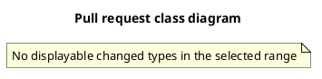

# Pull Request 差分クラス図

`umlgen diff` は、Git リビジョン間で変更された Java／Go の型とその周辺だけを切り出し、編集可能な PlantUML クラス図を生成します。追加された型は緑、変更された型は黄、削除された型は赤で表示されるため、レビュー時の設計影響範囲を素早く把握できます。

実際の出力例は [`examples/order-service/README.md`](../examples/order-service/README.md) を参照してください。

開発版では`--diagram package`でパッケージ依存の差分も生成できます。[package差分の契約](#パッケージ依存の差分開発版)を参照してください。以下の既定動作・GitHub Actions・変更型の説明は`--diagram class`（省略時）を対象とし、package差分の固定snapshot規約とは異なります。

## 導入方法

### GitHub Actions（おすすめ）

再利用可能なワークフローを呼び出すと、Pull Request ごとに差分図の `change-diagram.puml` / `.svg` と変更後の全体図の `full-diagram.puml` / `.svg` を同じ Actions artifact として保存できます。ソースコードを外部サービスに送信しません。

利用リポジトリに `.github/workflows/umlgen-diff.yml` を作成します。

```yaml
name: UML diff

on:
  pull_request:
    types: [opened, reopened, synchronize, edited]

permissions:
  contents: read

jobs:
  umlgen-diff:
    permissions:
      contents: read
    uses: Mino829/umlgen/.github/workflows/umlgen-pr-diff.yml@main
    with:
      source: src/main/java
```

導入直後の試用では `@main` を利用できます。本運用では、umlgen のリリースタグまたは完全な commit SHA へ固定することを推奨します。

実行後、Actionsのrun summaryから適用条件と比較commitを確認し、`umlgen-pr-diff` artifactをダウンロードします。対応する開発版workflowでは次の5ファイルを保存します。

```text
change-diagram.puml
change-diagram.svg
full-diagram.puml
full-diagram.svg
review-scope.json
```

全体図は PR の head commit の Java ソースから生成されます。削除された型や差分の変更色は含まれません。Java ファイルの変更がない PR でも生成されます。

開発版workflowではPR本文の`umlgen` blockから、差分図の`--include`／`--relations`／`--depth`／`--direction`を指定できます。全体図には適用しません。構文・上限・安全境界・本文編集時の再生成と結果の読み方は[PR本文フィルタ](github-actions.md#pr本文でレビュー範囲を指定する開発版)を参照してください。

ワークフローの入力・出力・セキュリティに関する詳細は [`docs/github-actions.md`](./github-actions.md) を参照してください。

### ローカル CLI

[README のインストール手順](../README.md#インストール)に従って `umlgen` をインストールします。

```bash
# 直前のコミットとの差分
umlgen diff HEAD~1

# main ブランチとの PR 差分（merge-base を使用）
umlgen diff main...HEAD

# 2 点指定（main の直後から HEAD まで）
umlgen diff main..HEAD

# SVG も同時に生成（ローカルに PlantUML が必要）
umlgen diff main...HEAD --format svg
```

デフォルトの出力先は `change-diagram.puml` です。

## パッケージ依存の差分（開発版）

```bash
umlgen diff main...HEAD --diagram package --dependency-source both --explain
umlgen diff HEAD~1..HEAD ./src --diagram package --language go \
  --external show --format png --renderer local --output package-changes.png
```

既定出力は`package-change-diagram.puml`。明示した`--output`やYAMLの`output.file`を優先し、画像失敗時は同名の`.puml`と説明を保持します。packageのYAML namespace `diagrams.package`、CLI優先度、config-relativeパスも全体package図と共通です。新しい公開JSON APIや別のworkflowは追加していません。

### 比較するソースと設定

| package差分の指定 | 固定する比較元 | 固定する比較先 |
| --- | --- | --- |
| `REV` | REVのcommit | HEADのcommit |
| `A..B` | Aのcommit | Bのcommit |
| `A...B` | AとBの一意なmerge-base | Bのcommit |

rangeの省略端点はHEAD。両側を完全なcommit SHAへ一度解決し、変更ファイルだけでなく、**選択範囲内の未変更ファイルも全件解析**します。複数merge-baseで曖昧な比較は拒否します。現在の作業ツリー・index・未追跡ファイルはソースにもmodule設定にも使いません。既存class diffの単一revision／working-tree規約は変えません。

Goは各revisionの最寄りの`go.mod`へキャッシュ済み構文を再束縛します。対象sourceより上位のrepo内moduleもGitから読み、repo外や現在のcheckoutへフォールバックしません。build tags・replace・go.work・classpathを評価したbuild graphではありません。Javaは選択root、Goはmoduleディレクトリ（moduleなしは所在ディレクトリ）を文脈として同名packageを分離します。

設定は呼出時のCLI／YAMLで固定し、両commitへ同じsource・include・exclude・関係選択を適用します。過去の`.umlgen.yaml`を自動採用しません。対象はrepo内のパスで、片側で消えたディレクトリ／ファイルも選択できます。両側に存在しない対象はエラー。選択したsource symlink／submoduleと非通常形式の`go.mod`は未対応として拒否し、空の解析結果に読み替えません。

package差分ではGitの`refs/replace`を無効にしてrevision解決・merge-base・tree・blobを読みます。commit／tree／ソースblob／go.mod blobの置換refで、表示したSHAを保ったまま解析内容を書き換えることはできません。既存class diffのGit規約は変更しません。

設定ファイルの絶対パスがrepo rootの別名（macOSの`/var`／`/private/var`やroot symlink）を使う場合も、repo rootだけを正規化して選択します。その下のGit相対パスは維持するため、削除済みtargetは選択でき、source symlinkをrepo全体へ誤って読み替えることはありません。

### 変更と不確かさ

図は表示対象のbefore／after unionを描き、追加は緑、削除は赤、根拠変更は青、不確かは黄、変更なしの文脈は灰色で区別します。各辺の`types`／`imports`は両側別の件数です。

- 複数ファイルの根拠が同じ辺を支える場合、一部の削除は**辺を保持した根拠変更**。最後の根拠が消えて初めて辺の削除になります。同じ件数のまま根拠が入れ替わった場合も区別します。
- 根拠の意味と元ファイルをmultisetとして比較します。行番号・byte span・ソースhash・順序だけの変化は無視し、重複importの件数は保持します。ソースfileのrenameは根拠変更、package名・module名・moduleディレクトリの変更はidentityの削除＋追加。曖昧なrenameの推測はしません。
- `--explain`は追加／削除根拠の位置・hash・各Git snapshotの最大3行の抜粋と、両側の失敗・未解決・既知の非表示対象を表示します。現在のファイルを再読込せず、説明の有無で図は変えません。
- `--external hide|show`と`--cycles off|mark|only`は通常package図と共通ですが、**比較は表示を絞る前の両側graph**で行います。cycles-onlyはどちらかの側で循環に属するpackageのunionを表示し、残っている辺を偽の削除へ変換しません。
- SCCは種類とメンバー集合で比較し、分割／統合はグループの削除／追加として表示します。呼出経路やコンパイル可否ではありません。解析失敗時は不確か、未解決／曖昧参照があるsource packageの辺や関係する循環も確定的な追加・削除・解消にしません。無関係のpackageまで一律に未解決扱いにはしません。
- 未対応のJava module宣言等でpackage所属の完全性を確認できない場合、辺や循環だけでなくpackage自体の追加・削除も不確かとして表示します。未対応入力から「packageが消滅した」と断定しません。

対応flagは`--dependency-source`、`--external`、`--cycles`、`--relations`、`--include`、`--exclude`、`--language`、`--no-cache`、`--explain`、配置・出力・renderer設定。`--focus`／`--depth`／`--direction`とclass専用flagは拒否します。関数呼出しや外部依存本文の比較は対象外です。

| 結果 | 終了コード | 出力 |
| --- | ---: | --- |
| 完全な選択範囲の比較（変更なし・片側空・未解決診断を含む） | 0 | union図と要求した説明 |
| Git／対象読取失敗、未対応の入力形式 | 1 | 既存図を保持 |
| 引数／設定エラー | 2 | 既存図を保持 |
| 一部のsource解析失敗 | 3 | 不確かな差分・診断を出力 |
| 片側の選択sourceが全件解析失敗 | 3 | 既存図を保持、要求した診断を出力 |
| 出力書込失敗 | 4 | エラーを報告 |
| 画像renderer失敗・期限超過・空画像 | 5 | `.puml`と説明を保持 |

未解決診断だけでは構文解析失敗の終了コードにはしません。図の`complete`はsourceのparse成功を表し、全参照の解決やbuild成功を保証しません。未解決のある辺・循環は別途`uncertain`として説明します。全体package図は部分解析成功を終了コード0にするため、この差分専用の終了コード規約と混同しないでください。

[実ソースとGit操作の利用例](../examples/package-diagrams/README.md#gitの両側から根拠の変化を読む)を参照してください。既存の再利用Actions workflowは引き続きclass diffを生成し、配布版の既定値も今回変更していません。

## 使い方

### リビジョンの指定

`umlgen diff <revision-or-range>` として、Git でサポートされている形式をそのまま利用できます。

| 指定例 | 意味 |
| --- | --- |
| `HEAD~1` | 1 つ前のコミットと現在の HEAD を比較 |
| `main...HEAD` | `main` と `HEAD` の merge-base から `HEAD` までの差分。PR 差分に最も近い |
| `main..HEAD` | `main` から `HEAD` までの差分。merge-base 以降に main 側で追加されたコミットも含む |
| `<commit>` | 指定コミットと作業ツリーの比較 |

### 周辺型の表示

`--depth` で、変更された型から何段先の関係まで図に含めるか指定できます。デフォルトは `1` です。

```bash
# 変更型のみ
umlgen diff main...HEAD --depth 0

# 2 段先まで
umlgen diff main...HEAD --depth 2
```

`--direction` で関係の探索方向を選べます。

```bash
# 変更型が依存する型だけ（下流）
umlgen diff main...HEAD --direction out

# 変更型に依存する型だけ（上流）
umlgen diff main...HEAD --direction in

# 双方向（デフォルト）
umlgen diff main...HEAD --direction both
```

### パッケージと配置方向

```bash
umlgen diff main...HEAD --package-grouping hierarchical \
  --layout-direction left-to-right --skinparam linetype=ortho
```

`--package-grouping`は`flat`（既定）・`hierarchical`・`none`、`--layout-direction`は`top-to-bottom`（既定）・`left-to-right`から選択します。配置方向は、依存関係の探索に使う`--direction in/out/both`とは別です。`.umlgen.yaml`の`layout`設定も利用できます。

タイトルと追加・変更・削除の色は維持され、プレースホルダ図にも配置方向と安全なskinparamが反映されます。対応するskinparamはREADMEの「パッケージ表示とレイアウト」を参照してください。

### 色の意味

| 色 | 意味 |
| --- | --- |
| 緑 (`#palegreen`) | 追加された型 |
| 黄 (`#lightyellow`) | 変更された型 |
| 赤 (`#lightcoral`) | 削除された型 |

無色の型は、変更型の周辺（`--depth` 内）に含まれた未変更の型です。

### その他の主なオプション

`class` コマンドと同じフラグが利用できます。

```bash
umlgen diff main...HEAD \
  src/main/java \
  --output docs/change-diagram.puml \
  --format svg \
  --show-relation-labels \
  --relations inheritance,implementation,field \
  --title "PR class diagram"
```

`--explain`を付けると、差分図に表示した関係線の意味・根拠をファイル・宣言行・最大3行のソース抜粋付きで標準出力へ表示します。`--quiet --explain`なら通常の進捗表示を抑え、説明だけを読めます。削除ファイルは比較元のGit履歴から取得した本文を使い、`Git base`と明示します。作業ツリーの同じパスへ読み替えません。

表示可能な変更型がなくプレースホルダ図になった場合、未変更型の関係線や未解決参照は説明せず、解析範囲と失敗の情報だけを表示します。変更ファイルを解析できず終了コード3となる場合も、`--explain`で解析失敗の状況を読めます。「図に線がない」ことから依存がないとは結論しません。

`.umlgen.yaml` の `exclude` 設定も有効です。ただし、変更ファイルが `exclude` で除外されると、表示可能な変更型がなくなり「変更なし」相当のプレースホルダ図が生成されます。

## 精度・検出ルール

`umlgen diff` は Git の差分情報と AST 解析結果を組み合わせて図を生成します。その特性と限界を正しく理解して利用してください。

### 変更検出はファイル単位

`git diff --name-status --find-renames` でファイルごとの変更ステータスを取得し、以下のように扱います。

| Git ステータス | 扱い | 色 |
| --- | --- | --- |
| `A`（追加） | 追加 | 緑 |
| `M` / `T`（変更 / ファイル種別変更） | 変更 | 黄 |
| `R` / `C`（リネーム / コピー） | 変更 | 黄 |
| `D`（削除） | 削除 | 赤 |
| 未追跡ファイル | 追加 | 緑 |

**重要**: 変更判定は**ファイル単位**です。1 つの Java ファイルに複数の型が含まれていたり、メソッド本体だけが変更されていたりしても、そのファイル内の**すべての型が変更色で表示されます**。型単位やメソッド単位の差分検出は行いません。

### 削除されたファイルは Git 履歴から復元

削除された `.java` / `.go` ファイルは、base リビジョンの内容を `git show` で読み込んで解析し、赤で図に含めます。これにより、「PR 前に存在していた型が何を持っていたか」を図で確認できます。

### 周辺型の選定は関係グラフに基づく

`--depth` で指定した範囲は、変更型を起点にした関係グラフの BFS 距離です。関係の種類は継承、実装、フィールド型、引数型、戻り値型から構成されます。したがって、**メソッド本体内部の呼び出しや Spring の DI など、宣言に現れない依存は周辺型に含まれません**。

### 関係は宣言ベース

図に出る関係は以下に限定されます。

- 継承 (`extends`)
- 実装 (`implements`)
- フィールド型
- メソッド／コンストラクタの引数型
- メソッドの戻り値型

メソッド内部で呼び出している型、ローカル変数の型、リフレクションで動的に解決する型は関係に現れません。PR で「呼ぶだけ」になった型は、図上では追加／変更されても関係線が引かれないことがあります。

### 表示可能な変更型がない場合

`diff` モードでは、変更があっても型を抽出できないとき、エラーではなく「変更なし」相当のプレースホルダ図を生成して終了コード `0` を返します。

- 変更が `package-info.java` など型を含まないファイルだけ
- 変更型が `exclude` 設定で除外された結果、変更型が見つからない

プレースホルダ図の例:



変更されたファイルを解析できず、表示可能な変更型がない場合は終了コード`3`になります。`--exclude` の結果として対象ファイルが0件になる場合は、その手前で`no Java files found`エラー（終了コード`1`）になります。`diff`対象に`.java` / `.go`ファイルがそもそも存在しない場合も同様です。GitHub ActionsワークフローはJavaファイルの変更がないケースを事前に検知し、別のプレースホルダ図を生成します。

### 再利用ワークフローは Java 変更を検知

`.github/workflows/umlgen-pr-diff.yml` は `.java` ファイルの変更を検知します。Go プロジェクトでは「Java 変更なし」として処理されるため、Go プロジェクトで利用する場合はローカル CLI を使うか、独自のワークフローで `umlgen diff` を呼び出してください。

### クラス図本体の限界が継承される

`umlgen diff` の精度は、あくまで `umlgen class` の解析精度の範囲内です。したがって、以下は diff 図でも同様に扱われません。

- Lombok などが生成するメンバー
- リフレクションで解決する型
- プロジェクト外（外部ライブラリ）の未解決型との関係
- 匿名クラス、ローカルクラス、enum 定数固有の class body
- generic 型パラメータと境界の完全な型解析
- sealed 型の `permits` 一覧からの関係推論

詳細は [README の「現在の解析範囲」](../README.md#現在の解析範囲)を参照してください。

## トラブルシューティング

### 変更があるのに「変更なし」になる

- `source` / 対象パスが正しいか確認してください。特に Actions ではリポジトリ相対パスです。
- 変更が `.umlgen.yaml` の `exclude` 対象になっていないか確認してください。
- 再利用ワークフローは `.java` の変更のみを検知します。Go ファイルの変更は検知されません。

### 型が含まれていないファイルだけ変更された場合

`package-info.java` など型を含まないファイルだけが変更された場合、上述のプレースホルダ図が生成されます。umlgen v0.5.0 未満を使っている場合は、このケースで終了コード `1` となり CI が失敗する可能性があります。この挙動は、v0.5.0 以降で解消されています。

### 図に想定外の型が多く出る

`--depth` のデフォルトは `1` です。変更型の直接関係先が多い場合は図が大きくなります。`--depth 0` か、`--direction out` / `in` で方向を絞ってください。

### base / head が取得できない

Actions では `pull_request` イベントから呼び出すのが最も確実です。別のイベントから呼ぶ場合は、`base-sha` と `head-sha` を明示してください。

### セキュリティ

- ワークフローは `pull_request` イベントと `contents: read` だけを使用します
- Fork Pull Request では read-only の `GITHUB_TOKEN` で動作し、secret を要求しません
- `pull_request_target` は使用しません
- ソースコードは PlantUML Server へ送信されず、SHA-256で検証した PlantUML JAR を GitHub-hosted runner 内で実行して SVG を生成します
