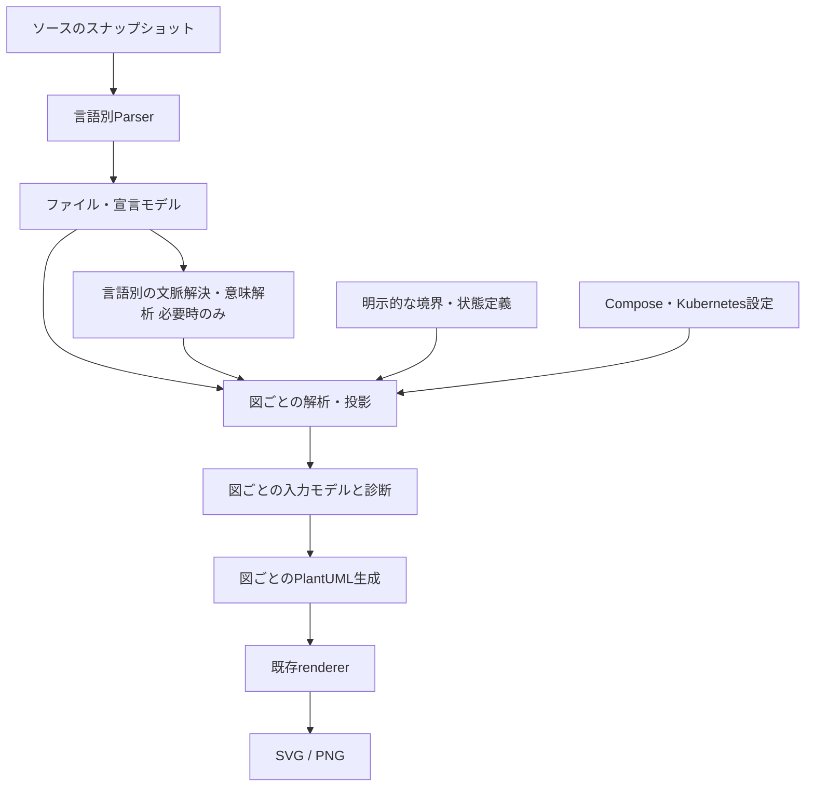
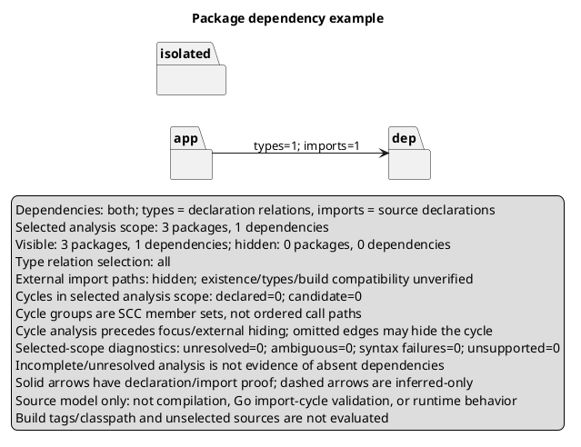

# UML図拡張の設計・開発計画

- 状態: **全体は開発計画。P1-01〜05（解析モデル・package graph・循環／範囲解析・PlantUML生成）は開発版で実装済み**。`package`コマンドとYAML接続はまだ含まない。
- 初回調査対象: `feat/learner-explanations`、コミット `1b6e4a0` の作業コピー。P1-01〜05の実装・検証結果は9節へ追記。開発版の機能を、mainへのマージ済み・リリース済みとは扱わない。
- 表記: **現状（実装確認）**はコードまたは実CLIで確認した事実、**提案**は今後の仕様、**未決定**は実装前の検証・判断が必要な事項。
- 関連方針: [開発方針](development-direction.md)、[差分機能](pr-diff.md)、[性能基準](performance.md)。既存文書の方針やPR本文フィルタの案は変更しない。

## 1. 結論と対象範囲

**提案:** 図の拡張順は、パッケージ図 → シーケンス図 → アクティビティ図・状態遷移図 → コンポーネント図・配置図とする。ユースケース図は明示的な要求モデルの入力を前提とする追加候補とし、ソースだけからの自動推定を約束しない。

理由は、パッケージ図では既存の型宣言・型関係・import解析を再利用できる一方、以後の図には現在保持していない関数本体、名前束縛、制御フロー、実行環境の情報が必要だからである。最初から全図を扱う汎用フレームワークへ置き換えず、必要になった中間表現だけを加える。

この順序は**図の種類の開発順序**であり、合意済みの製品優先順位「学習者のコード理解 → チームの設計レビュー → 日常的な開発利用 → エディタ・画面操作」を置き換えない。各図で根拠と限界を説明できることを先に満たす。watch、GUI、PR本文フィルタ、公開JSON APIの実装は本計画の初回パッケージ図に混在させない。

設計上の原則:

1. 宣言・設定から読めた事実、意味解析による解決、推定、手動定義を区別する。
2. 未解決の名前から、もっともらしい型・呼び出し・状態遷移を捏造しない。
3. 現在のクラス図のコマンド、既定値、通常出力、説明の軽量経路を維持する。
4. パッケージ名、型ID、図上のaliasを別物として扱う。
5. 生成した図は「指定範囲のソース／設定のモデル」であり、実行履歴や完全なシステム構成ではない。

## 2. 現状分析

### 2.1 ディレクトリ構成と責務

以下は調査対象の主要部分であり、全ファイルの一覧ではない。

```text
cmd/umlgen/main.go             CLI起動
internal/cli/                 コマンド解析、探索・解析・出力の組み立て
internal/config/              .umlgen.yaml、既定値、設定パス解決
internal/language/            Java/Go選択、言語別処理への入口
internal/scanner/             拡張子・パスによる探索
internal/java/                Tree-sitterによるJava宣言解析
internal/golang/              Go AST解析、型の統合、暗黙実装の推定
internal/model/               型・フィールド・メソッド中心のモデル
internal/relations/           型名解決、型間関係、根拠・診断
internal/focus/               型関係グラフの近傍抽出
internal/plantuml/            クラス図のPlantUML生成
internal/renderer/            PlantUMLからSVG/PNGへの変換
internal/gitdiff/             変更パスと削除ファイルの取得
internal/javacache/           Java/Goで共用する解析キャッシュ
internal/explain/             関係の意味・根拠・解析状況の表示
internal/benchmarks/          探索・Java解析・関係・生成・キャッシュ計測
testdata/java/compatibility/  複数module、同名型、壊れたJavaなど
testdata/go/compatibility/    domain/serviceを持つGo fixture
docs/ examples/ scripts/ .github/workflows/
```

### 2.2 READMEの記述と実装の区別

| 論点 | READMEで案内する仕様 | 実装から確認した範囲・注意点 |
| --- | --- | --- |
| 対応図 | Java/GoからPlantUMLクラス図を生成 | コマンドは`class`、`diff`、`init`、`cache`、`version`、`help`。`package`等はない |
| Goの実行・開発要件 | Go 1.24以上の案内 | [go.mod](../go.mod)の`go`ディレクティブは`1.25`。本書では実際の依存定義を基準にする |
| AST解析 | Java/Goを解析 | JavaはTree-sitter、Goは標準`go/parser`。どちらも現在の共通出力は型宣言で、コンパイラー相当の型検査ではない |
| パッケージ表示 | グルーピング、階層レイアウト | packageの枠の中に型を配置する。関係は型同士で、パッケージ間へ集約していない |
| Goのinterface実装 | 暗黙実装を可視化 | パースした型・メソッドの構文的シグネチャ照合。`go/types`による判定ではない |
| Git差分 | 追加・変更・削除を色分け | 基本単位は変更ファイル内の型。比較先コミットの完全な型・辺モデルを作る方式ではない |
| キャッシュ | ソース変更に応じて再解析 | 内容ハッシュ中心。Goのmodule文脈はP1-01で構文キャッシュから分離し、取得後に現在の配置へ再束縛する |
| 外部送信 | ローカル解析を中心とした説明 | 解析のためにソース全体を送信する経路はない。ただし明示的な`--renderer server`は**生成したPlantUML**を送信する。機密な型名等も含み得る |
| 性能 | キャッシュによる高速化 | 既存の参考値は特定環境・単一Javaソースの計測。全言語・全コマンドの速度保証ではない |

READMEは[README.md](../README.md)を参照。ここで見つけた差異の修正は、本ドキュメント作成には含めない。

### 2.3 Javaの解析

**現状（実装確認）:** [internal/java/parser.go](../internal/java/parser.go)の`ParseSource`は、Tree-sitter Java grammarで構文木を作り、構文エラーがあればそのファイルの解析を失敗させる。解析後は木とparserを閉じる。

- class、interface、annotation、enum、record、型直下のネスト型を抽出する。メソッド内のローカル型や匿名クラスを網羅する仕組みではない。
- package、importの名前・wildcard・static、親型、修飾子、型パラメーター、フィールド、メソッド／コンストラクターのシグネチャを保持する。
- 型・メンバーは既存の開始ファイル／行を保持する。P1-02の`SourceUnit`はファイル全体、package節、importに物理byte範囲・行・byte列を持つ。型・メンバー全体の終端spanはまだない。
- enumの定数名は取れるが、初期化式や状態遷移としての意味は持たない。
- 関数本体、呼び出し式、ローカル変数、制御構造、throws、例外経路、annotation要素の既定値は共通モデルへ保存しない。
- importはファイル単位で一度保持し、型は同じsliceを参照する。`package-info.java`等の型0件ファイルも`SourceUnit`として返す。`module-info.java`はmodule宣言のspanと`unsupported-module-declaration`診断を保持するが、module依存へは変換しない。

Tree-sitterは構文を読む基盤であり、外部JAR、オーバーロード、継承先への名前束縛をそれだけで解決するものではない。[S2][S6][S7]

### 2.4 Goの解析

**現状（実装確認）:** [internal/golang/parser.go](../internal/golang/parser.go)は`go/parser.ParseFile`と`parser.AllErrors`を使う。エラー時に部分的ASTからモデルを返す方式ではない。

- 型宣言、structのフィールド・埋め込み、interfaceのメソッド・埋め込み、レシーバー付きメソッドのシグネチャを抽出する。
- **レシーバーのない関数の宣言・本体はスキップする。`main`、`init`、通常のパッケージ関数と、その本体・呼び出しは現在の型モデルにない。** 型0件の関数ファイルも、package節・importを持つ`SourceUnit`として残る。
- 非struct/interfaceの型もクラス図向けの型へ投影し、合成フィールド`value`を使う。型aliasと定義型の意味上の区別は保持しない。
- importにはaliasを保持し、dot／blankもそのまま区別する。`ParseSource`／`ParseFile`はpackage節を含む`SourceUnit`を返し、キャッシュ保存後の`BindContext(unit)`がソースの祖先から`go.mod`を探してmodule名と相対ディレクトリで`PackagePath`と型のpackage完全名を構成する。見つからない場合はpackage節へフォールバックする。
- `go.work`、replace、実際のビルド対象、依存パッケージの型情報をロードしない。`_test.go`は言語側の対象から除外するが、GOOS/GOARCHやbuild tagsによる選別はない。
- `Finalize`で同じ完全名の型・別ファイルのメソッドを統合する。クラス図の型へ投影したimportは従来どおり統合されるが、各`SourceUnit`のimportは独立して保持する。**既存クラス図resolverのファイル別alias解決はこの変更で拡張しない**。新しいpackage graphでは元のunitを使う。
- interface実装は、解析済み型のメソッド名・引数型文字列・戻り値型文字列を比較する。ポインタレシーバーと埋め込みを考慮するが、型alias、ジェネリクス、type set、曖昧な昇格等を含むコンパイラーの完全な判定ではない。空の要件集合は推定対象から外す。
- 型は`T`と`*T`で別ノードではない。説明要求時には一致判定に実際に使ったメソッドを記録する。

この推定を、そのままinterface経由の呼び出し先やchannel通信相手の確定に流用してはならない。

### 2.5 内部モデル・型関係

参照: [model/model.go](../internal/model/model.go)、[relations/relations.go](../internal/relations/relations.go)。

| 現行モデル | 保持するもの | 拡張時の不足 |
| --- | --- | --- |
| `SourceUnit` | 言語、物理パス、SHA-256、ファイルspan、package節、import、型、構文／非対応診断、実行時PackagePath | ソース本文・AST・意味解析IDなし。パスとmodule文脈はキャッシュ対象外 |
| `Project` | クラス図向け`Types []Type` | package graphは別の`packagegraph.Graph`で保持する。関数・module依存はまだない |
| `Type` | package/name/enclosing/kind、imports、fields、methods、extends/implements、変更区分 | ソース本文・本体・意味解析IDなし。`Source`はキャッシュJSON対象外 |
| `Method` / `Parameter` | 名前、型文字列、修飾子、レシーバー情報、開始位置 | 自由関数、呼び出し、文、例外、CFGなし。戻り値も型文字列中心 |
| `Import` | 名前、alias、wildcard、static、物理span。所属ファイルは所有SourceUnit | package所有先・曖昧候補は`packagegraph`の解析結果に保持し、構文記録へ混ぜない |
| `TypeReference` | 名前、Source/Line、Inferred | 名前束縛の候補集合や分析文脈なし |
| 関係・根拠・診断 | From/To、種類、label、多重度、宣言位置、推定、未解決／図の外 | 型関係以外の語彙や、実行順序・遷移のモデルなし |
| `packagegraph.Graph` / `View` | 文脈付きPackageID、集約辺、宣言／候補SCC、focus前の解析範囲と表示射影、元位置・診断 | CLI、コンパイラーによる意味解析はまだない。図生成は`plantuml.GeneratePackage`へ分離 |

`relations.Build`は軽量な関係生成、`Analyze`は根拠と診断を含む処理である。対象は継承、実装、フィールド、引数、戻り値の5種類。型文字列から参照名を抽出し、既知の型、同じpackage、明示import、wildcard等で解決する。**importそのものは関係線ではなく、ローカル変数や式での利用も含まない。**

制約:

- wildcardの複数候補を意味的に検証する仕組みはなく、候補順の影響がある。Goのalias省略時の名前も、import先のpackage節ではなくパス末尾から推測する。
- Go埋め込みを内部の`inheritance`へ投影するため、Java継承と同じ意味と説明してはいけない。
- 型の自己辺は表示しない。関係の重複排除キーは端点・種類・label・多重度で、根拠の位置は別途保持できる。
- 多重度は配列・コレクション等の型表記に基づくヒューリスティックであり、実行時個数や所有権ではない。

新しい図のために既存resolverを無条件に「正確な名前解決器」と位置付けず、曖昧性を保持する新しい解析経路を限定的に加える。

### 2.6 PlantUML生成と画像化

[plantuml/generator.go](../internal/plantuml/generator.go)の`Generate`は型ノードを出し、`relations.Build`からクラス図の線を出す。`Options`もメンバー表示、型関係、package wrapper、レイアウトを含むクラス図中心の設計であり、汎用グラフIRではない。

- flat／hierarchical／noneは**型を囲む枠**の違い。hierarchicalはJavaのドットやGoのパス構造を扱うが、packageノード同士の依存には変換しない。
- クラス図の生成経路は維持し、package図はP1-05の`GeneratePackage(View, PackageOptions)`で別生成する。安全なpreamble・layout検証を再利用し、packageの名前・titleは指示やリンクにならない文字escapeを行う。`PKG_n`等の図上aliasは永続的なPackageIDにしない。
- `IncludesRelation`等、一部の表示判定は生成オプションに結び付いている。新しい図の解析がクラス図用オプションへ依存しないようにする。

[renderer/renderer.go](../internal/renderer/renderer.go)はモデルに依存せず、生成済みPlantUMLをSVG/PNGへ変換する。`auto`はローカル実行→JARで、サーバーへ自動フォールバックしない。タイムアウト、プロセス終了待ち、出力欠落・空ファイルの検査を再利用できる。PlantUMLの図種別・バージョンによる構文差は別途検証が必要で、全UML表記への完全準拠は主張しない。[S10]

P1-05の内部APIでは、実際のPlantUML 1.2026.6でpackage図のSVG／PNGを検証済み。`package`コマンドはP1-06で接続するため、現行CLIで新コマンドを実行できるという意味ではない。

### 2.7 Git差分とキャッシュ

#### Git差分

[gitdiff/gitdiff.go](../internal/gitdiff/gitdiff.go)は`git diff --name-status --find-renames`でJava/Goの変更パスを取得する。削除ファイルは比較元から`git show`で読み、追加／変更側は**現在の作業ツリー**から解析する。triple-dotの比較元はmerge-base。untrackedも追加対象へ含める。

したがって、現在の`diff A..B`を「AとBの完全な静的モデル比較」と解釈してはいけない。rename/copyは新しいパスを変更扱いにし、変更されたファイルの全型に同じ変更区分を付ける。変更ファイル内だけで削除された型・辺を完全復元する処理や、辺独自の追加／削除モデルはない。

**提案:** パッケージ差分は後述のPhase 1Bで両側の完全なスナップショットから集約する。変更ファイルだけの集約で「packageが消えた」「循環が解消した」と判定しない。既存`diff`の既定動作は維持し、新しい図のスナップショット規約を明示する。

#### 解析キャッシュ

[javacache/cache.go](../internal/javacache/cache.go)は名前にJavaを含むが両言語で使う。parser schema、バージョン、解析設定からsignatureを作り、signatureとソース内容のSHA-256をキーにする。図の表示・renderer等はCLI側で解析キーから除外する。P1-02では`SourceUnit`をJSON保存し、型0件もhitにする。読み込み時にunit／宣言のパスと型のファイル別import参照を復元する。AST・ソース本文・パス・実行時PackagePathは保存しない。

**初回調査で再現した問題（P1-01で修正済み）:** 同じ`package domain; type User ...`のバイト列を、`module example.com/a`と`module example.com/b`へ配置し、共通の空キャッシュでA→Bの順に実行した。Bはcache hitになり`example.com/a.User`を出した。Bを`--no-cache`で実行すると正しく`example.com/b.User`になった。ファイル内容のキーにmodule文脈がなく、読み込み時にも`Type.Package`を再計算しないためだった。

**P1-01・02実装済み:** 構文キャッシュとpackage文脈を分離し、取得後に現在のmoduleへ再束縛する。P1-01でGo schemaを`go-ast-v3`へ更新し、ファイルモデルを導入したP1-02では`go-ast-v4`／`java-tree-sitter-v3`へ更新。ファイル単位のpackage/import・物理位置を保存し、本文やASTは永続化しない。詳細は5.5節、9節を参照。

### 2.8 CLI・設定・探索・focusの制約

- [cli/cli.go](../internal/cli/cli.go): `runClassMode`にフラグ、探索、解析、finalize、フィルター、差分、生成が集まる。新図のための最小の処理抽出は必要だが、全コマンドの再設計を前提にしない。
- [language/language.go](../internal/language/language.go): parserの契約は`*model.SourceUnit`を返す。クラス図はその`Types`を入力にする。単一実行で1言語を選ぶ設計で、混在言語横断の解決器はない。
- [config/config.go](../internal/config/config.go): yaml.v3で既定値へ読み込む。source/outputは設定ファイル基準で解決し、CLIによる上書きパスはcwd基準。未知のYAMLキーを一律に拒否する実装ではない。
- [scanner/scanner.go](../internal/scanner/scanner.go): 拡張子、既定の除外ディレクトリ、明示パターンで探索し、絶対パスを重複排除・ソートする。`.gitignore`や真のglob一般を解釈する機能ではなく、明示ファイル指定と再帰探索で除外の適用差もある。
- CLIのexcludeは設定リストへの追加ではなく置き換え。include/package除外には解析後の型フィルターもある。削除ファイルは通常探索を経由しないため、全経路へ同一に適用されるとは限らない。
- [focus/focus.go](../internal/focus/focus.go): 型名を解決し、型関係でBFSする。現在は`--relations`の表示絞り込みがBFSの辺を制限しない。package／call用focusへそのまま流用できない。
- 既存の`--depth`はfocusからの関係距離で、再帰呼び出しの展開回数ではない。`diff`とfocusの併用は現在禁止されている。

## 3. 図の比較と優先順位

**提案の比較表。** 精度は数値保証ではなく、得られる証拠に対する評価。「構文上の事実」でもビルド成功・実行を証明するわけではない。

| 順位・図 | 主な用途 | 必要な追加解析・入力 | 難易度 | 推定精度・成立範囲 | 既存機能の再利用 |
| --- | --- | --- | --- | --- | --- |
| 1 パッケージ | 学習時の全体像、依存方向・循環のレビュー | ファイル単位package/import、型関係集約、SCC | 低〜中 | 宣言上のimportと解決済み型依存は追跡可能。実際の利用・ビルド依存全体とは異なる | 高: 探索、AST、型、関係、キャッシュ、renderer |
| 2 シーケンス | entryからの処理理解、API内部レビュー | 関数本体、名前束縛、callsite、Call Graph、構造化領域 | 高 | 直接呼び出しは比較的確実。動的dispatchは候補集合、実行値・実行順全体は不明 | 中: 探索、宣言、位置、説明、renderer。型関係だけでは不可 |
| 3A アクティビティ | 単一関数の分岐・ループ・終了経路の理解 | 本体AST、CFG、必要に応じて例外・SSA | 中〜高 | 構文上の制御構造は比較的確実。到達可能性、例外、並行性は条件付き | 中: parser基盤、位置、renderer |
| 3B 状態遷移 | プロトコル・ライフサイクル確認 | 状態フィールド／enum、代入・guard、明示状態定義 | 高（自動推定） | 明示定義は定義として正確。状態名だけの自動抽出は低く、完全機械は保証不可 | 低〜中: 型・enum・位置、CFG、renderer |
| 4A コンポーネント | 境界と提供／要求関係の設計レビュー | package/module集約ルール、境界の明示定義 | 中 | 定義した境界への投影は明確。packageだけから責務を確定できない | 高: package graph、設定、説明、renderer |
| 4B 配置 | サービス／artifact／実行基盤の理解 | Compose、Kubernetes、ソースとartifactの対応設定 | 中〜高 | 宣言された構成を表示。実際の配置・疎通・通信は未観測 | 中: 設定読込、componentモデル、renderer |
| 追加 ユースケース | 利用者と目的の共有、要求レビュー | actor・goal・system boundary・関連の明示定義 | 描画は低／自動推定は高 | 要求定義の転記は可能。publicメソッドから利用者の目的は確定不可 | 低: 設定、根拠、renderer中心 |

## 4. 各図の解析・生成方針

### 4.1 Phase 1: パッケージ図

#### 二つの依存を混同しない

**P1-03の内部APIは実装済み:** `declared-types|imports|both`を分け、未指定は`declared-types`とする。**CLIは提案のまま:** 後続P1-06で`--dependency-source`へ接続する。

- `declared-types`: 継承／実装／フィールド／引数／戻り値として参照され、対象packageを解決できた型関係を集約する。現在のクラス図と対応付けやすい。ただしメソッド本体内の依存を含む「全依存」ではない。
- `imports`: ソースに書かれたimport宣言の関係を表示する。未使用かどうかや実行時の利用は主張しない。Goのblank importは初期化副作用の宣言であり、型参照がなくても残す。[S3]
- `both`: 同じpackage対へ集約しても、型関係件数とimport宣言件数を別々に持つ。二つを足して「利用回数」にしない。

Javaでは、`import p.Outer.Inner`や`import static p.Outer.member`の末尾を単純に削ってもpackageにならない。既知の型索引から所有型と`Type.Package`を解決する。`p.Outer.*`は型のメンバー型のimportでもあり得るため、既知のpackage／所有型で分類できない場合は未解決にする。wildcard、static、ネスト型の曖昧性を保持する。暗黙の`java.lang`や同一package参照を、書かれていないimport宣言として水増ししない。[S5]

Goではimport文字列を宣言されたimport pathとして保持し、alias／dot／blankをファイル単位に残す。文字列としての依存先は分かっても、存在・build互換・型情報は未検証とする。alias省略時の識別子をパス末尾から確定しない。[S3]

#### 集約と循環

- ノードIDは言語、解析root／module文脈、canonical package名から作る。P1-03の`Source.Context`は呼び出し側が実際のroot／module識別子を明示する。Javaの無名packageはsource rootで区別し、Goはpackage節だけで同一視しない。表示名が同じでも異なる文脈を勝手に統合しない。
- 型なしのGoファイル、Javaのpackage宣言だけのファイルも`SourceUnit`で保持する。Javaのmodule宣言はpackageではなく、初回は未対応診断として保持する。
- 型依存は一意な型関係レコード、importは元ファイルの宣言位置で数える。Typeへ複製された同じimportを型数だけ数えない。根拠一覧と集約件数は対応する。
- 同一package内の関係はpackage間の辺・循環から除き、必要なら内部依存件数として説明する。階層の親子関係を依存の辺にしない。
- 外部参照は内部ノード、既知の外部package、未解決参照を分ける。Goの明示import pathは外部ノード化できる。Javaでpackage境界が分からない名前を外部packageとして捏造しない。
- P1-04でSCC（強連結成分）を検出する。SCC走査はO(V+E)、根拠分類・出力ソートの費用は別。通常の宣言／importで成立する循環と、推定実装を含めて成立する候補循環を分ける。表示を省略した辺・対象外ファイルの存在を注記し、「循環なし」をリポジトリ全体へ一般化しない。
- Javaのpackage循環は直ちにコンパイルエラーではない。Goもbuild tags未選別の全ファイル和集合なら、実際の特定buildに成立する循環とは限らない。コンパイラーのimport-cycle判定とは別物と表示する。

### 4.2 Phase 2: シーケンス図

**提案:** 「entryからの静的な呼び出し候補と制御構造の投影」として提供する。Call Graphだけを走査順に並べて実行順としない。

1. 自由関数、メソッド、コンストラクター、初期化処理、関数リテラル／lambdaを識別し、本体とcallsiteの位置を抽出する。Goの`main`/`init`も対象に加える。
2. entryは一意なCallableIDへ解決する。単純名が複数ある場合は候補を示してエラーにし、最初の関数を選ばない。Javaは所有型＋引数型、Goはimport path＋関数名／レシーバーを指定可能にする。
3. 直接呼び出し、動的候補、未解決を分けたCall Graphを構築する。辺は「呼び出す可能性がある」を意味する。[S8]
4. ASTの構造化領域と評価規則から`alt`、`opt`、`loop`等を生成し、最大展開深さ、再帰、循環、参加者数・メッセージ数を制限する。到達した上限は省略箇所として見せる。
5. 引数はソース上の式・宣言型、戻りは戻り型／return式として表示する。実行値、ループ回数、採用された分岐は得られない。例外で後続引数が評価されない可能性も残す。

Goの型解決候補は`go/packages`＋`go/types`、必要な箇所でSSA／callgraphを利用する。ただし現在の依存にはなく、導入時のGoバージョン・ライブラリ版は別途固定する。`go/packages`は既定でgoコマンドを使い、環境によってdriverを使う。オフライン性、module download、cgoや外部ツールの実行境界を検証し、単なるAST解析と同じ実行条件とは扱わない。[S8]

JavaではTree-sitterを構文抽出へ残し、JDT bindingsまたはJavaParser＋SymbolSolverによる意味解析を比較する。classpath、source root、言語レベル、JVM導入・プロセス連携・配布サイズが必要になる。構文だけの独自resolverでオーバーロードや動的dispatchを確定したと称しない。採用backendは未決定。[S6][S7]

並行・動的処理の表現:

- Goのinterface／関数値呼び出しは、判明した候補集合とその解析方式を示す。候補全てが実行される図にしない。
- `go f()`は非同期起動として描く。呼び出し元の後続処理、子の開始・終了の完全な順序は主張しない。`par`も可能な並行性の表現で、実測スケジュールではない。
- `defer`は登録時と実行時を区別する。`select`、channelの送受信は同一channelを同定できる範囲に限り、通信相手を名前や型だけで結ばない。[S4]
- Javaのvirtual/interface呼び出しは実行時クラスで対象が変わる。既知の継承階層の候補と、外部サブクラス・DI・proxy・reflection等の未確定を分ける。[S5]
- Javaの左から右の評価規則、Goの呼び出し・受信等の順序規則に従う。Goの全てのオペランドに単純な左から右を仮定しない。CFG/Call Graphに格納された辺の列挙順も意味上の評価順ではない。[S3][S5][S8]

### 4.3 Phase 3A: アクティビティ図

**提案:** まず単一の指定関数を対象にする。構造化本体を保持し、CFGで分岐先・終了先を検証してから描画する。

- if/else、switch、for/range、条件、ループback edge、break/continue、早期return、throw/panicを明示する。
- Javaのtry/catch/finally、例外による飛び先、finally内returnによる上書き、Goのdefer/recover、短絡評価は、通常分岐とは異なる辺・effectとして扱う。未対応なら対象位置付きで診断し、その経路を消さない。
- `go/cfg`は候補だが、条件そのものの辺表現、`&&`/`||`の短絡、panic等の異常フローを完全には提供しない。必要な正確性に応じてASTを補助情報にし、SSAを検討する。[S9]
- CFGはループ等を低レベルにするため、PlantUMLのif/while構造へ戻すには元ASTとの対応が要る。非構造化フローを常に自然な入れ子へ変換できるとは仮定しない。
- losslessな表現ができない場合は明示ノード・接続への限定的な表現、またはその関数を非対応として報告する。もっともらしい正常系だけを成功図として出さない。

### 4.4 Phase 3B: 状態遷移図

**提案:** enum抽出と状態機械の復元を分ける。最初は明示定義＋ソースで確認できる代入の照合を提供する。

- 対象型、状態フィールド、状態集合、初期状態、イベント、guard、action、遷移をYAMLで指定可能にする。設定由来の遷移には`configured`という根拠を付ける。
- enumや定数、対象フィールドへの代入は候補として抽出する。フィールド名に`state`を含むことや`Open/Closed`の名前だけで状態・遷移を確定しない。
- 代入先は分かっても直前状態が分からない場合、`unknown -> Closed`という観測候補に留めるか診断する。全状態からClosedへの辺を生成しない。
- guard、別関数経由の更新、alias、永続化からの復元、並行更新は解析範囲を表示する。JavaのコンストラクターやGoのゼロ初期化だけでシステムの初期状態を断定しない。
- 複合状態、履歴状態、並行状態、時間制約、完全なライフサイクル検証は初回に含めない。明示定義の矛盾や未宣言状態の参照はエラーとして扱う。

状態定義の実行は行わず、guard/actionは表示用の文字列・ソース参照とする。コードを任意評価する設定機構にしない。

### 4.5 Phase 4: コンポーネント図・配置図

**コンポーネント（提案）:** Phase 1のpackage graphを、明示した境界定義へ投影する。

- package prefix、module、ソースroot等からcomponentへのマッピングを設定する。packageやディレクトリを、そのままアーキテクチャ上の責務だと断定しない。
- 境界の重複・曖昧な所属はエラーまたは未所属診断とし、先勝ちにしない。内部依存は集約し、component間の辺に元package／型の根拠を残す。
- Go moduleとJava module／ビルドmoduleは区別する。`go.mod`、`go.work`、Maven等は入力候補だが、依存ライブラリ宣言と実際のソース利用は異なる。任意のGradleスクリプトを自動実行しない。
- 提供／要求interfaceは明示設定または証拠のあるAPI情報から描く。Goの全interface、Javaの全public型を自動でサービス境界としない。

**配置（提案）:** 設定ファイルから読める希望構成を別モデルとして保持する。

- Compose: service、image、build、公開port、network、volume、`depends_on`を読む。`depends_on`は起動・停止順等の宣言で、HTTP/RPC通信の証拠ではない。短縮形だけではhealthy待機も意味しない。[S11]
- Kubernetes: Deployment等のworkload、Service、selector、宣言されたport等を入力候補にする。selectorの一致は対象候補であり、実際の通信や実行nodeを証明しない。selectorなしService、動的EndpointSlice等は別扱いにする。[S12]
- component→artifact/image→workload/nodeの対応は明示設定を基本とし、名前の類似で自動結合しない。
- node配置、replicaの稼働状態、実行時endpoint、外部サービス等がソース／設定にない場合は`unknown`にする。実クラスタ問い合わせやトレース取得は別機能であり、初回には含めない。
- Composeの変数展開、複数ファイルmerge、Kustomize/Helm等は仕様差が大きい。初回は対応範囲を固定した入力、または利用者が事前生成したmanifestを受け取り、未展開値は未解決として表示する。ツール側でプロジェクトの生成スクリプト、Docker、Helmを実行しない。
- Secretや環境変数の値は図へ出さない。設定ファイル由来の関係とコード由来の関係を別種別にする。

### 4.6 追加候補: ユースケース図

actor、利用目的、system boundary、include/extendの意味はソースのメソッド一覧からは得られない。認可annotationやHTTP endpointも、利用者の目的そのものではない。

**提案:** 将来、要求文書と対応する明示定義を入力し、actor／use case／関係を描く。実装のentryやテストへのリンクは根拠として加えられるが、業務目的を自動命名しない。実装順ではPhase 4後の任意拡張とし、要求モデルの維持責任・コードとの同期方法が決まるまで着手しない。[S1][S10]

## 5. アーキテクチャ案: 必要な部分から共通IRへ

### 5.1 現行モデルの拡張か、新IRか

**提案:** `model.Type`を巨大な万能モデルにせず、既存の宣言モデルを再利用する小さなファイル／グラフモデルを追加する。最初の変更は`SourceUnit`とpackage graphに限定する。Call Graph、CFG、deployment等を空のフィールドや未使用interfaceとして先に実装しない。

- `Type`、`Field`、`Method`、既存の型関係はクラス図の入力として維持する。
- parser内部で一度読んだASTからファイル情報と型を得る入口へ段階的に移行する。`Type.Imports`から元ファイルを逆算する方式は採らない。
- parser契約を変更する際は言語backend、CLI、キャッシュ、fixture等の全呼び出し元を一緒に移行し、旧APIの互換shimを常設しない。外向きのクラス図CLI互換と、内部API不変は別である。
- `internal/ir`のような新しい総合ディレクトリは現時点で必須ではない。まず`internal/model`とpackage専用モジュールで足りるか検証し、複数の実利用が生じた共通要素だけを抽出する。

### 5.2 データフローと責務

以下は**将来案**。現在、意味解析や他図の生成経路が存在するという図ではない。



| 層 | 責務 | 持ち込まないもの |
| --- | --- | --- |
| Parser | 構文、宣言、import、位置、必要時の本体構造 | 端末説明文、PlantUML alias、推測した外部型 |
| 言語別意味解析 | import／名前束縛、型検査、dispatch候補、言語の評価規則 | 図の色、表示順、ユーザー向け長文 |
| 共通解析・図への投影 | 集約、SCC、範囲抽出、根拠、上限制御 | 言語固有の構文名の決め打ち |
| 図generator | 図固有の記法、escaping、安定した並び | ファイル再読込、型解決、ネットワーク |
| CLI | 選択、実行文脈、設定優先度、診断・終了コード | 独自の名前解決や状態推定 |
| renderer | PlantUMLから画像、時間制限、エラー | ソース解析、意味推定 |

### 5.3 段階的なモデル

型名・モジュール名は以下の設計用仮称で、公開スキーマの確約ではない。

| 導入段階 | モデル | 最低限の情報・不変条件 |
| --- | --- | --- |
| Phase 1（P1-02実装済み） | `SourceUnit` | 言語、物理パスと内容hash、ファイルspan、package節、実行時PackagePath、import一覧、既存Types、診断。型が0でも残る。root/module識別子はgraph入力の`Source.Context`で渡す |
| Phase 1（P1-03実装済み） | `packagegraph.PackageID` / `Package` | 言語＋明示文脈＋canonical名、内部／外部種別、所属ファイルとhash。aliasから独立 |
| Phase 1（P1-02・03実装済み） | `Import`／package解決結果 | 名前、alias/static/wildcard、Goのdot/blank、所有unit、物理span。解決先は集約辺、未解決・曖昧候補はgraph診断に保持 |
| Phase 1（P1-03実装済み） | `packagegraph.Dependency` | From/To、元の型関係レコードと全根拠、位置付きimport宣言。件数は各sliceの長さで別々に数える。同一package辺は除外 |
| Phase 2 | `CallableID` / `Callable` | package、所有型／receiver、名前、signature、本体位置、関数種別。自由関数・overloadを識別 |
| Phase 2 | `CallSite` / `CallGraph` | 呼び出し元、位置、receiver／引数式、候補先集合、直接／virtual／interface／async／deferred等、未解決理由 |
| Phase 2 | 構造化本体領域 | 順序、条件分岐、ループ、例外領域、各callsiteの所属。実行経路とは区別 |
| Phase 3 | `FunctionCFG` | entry/exit、basic block、normal/true/false/exception/return等の辺、元AST・位置との対応 |
| Phase 3 | `StateModel` | 状態、初期状態、event/guard/action、遷移、configuredと抽出候補の別 |
| Phase 4 | `ComponentModel` / `DeploymentModel` | 明示境界、interface、artifact、service/workload/node、宣言関係、元設定位置 |

全モデルを常時生成しない。クラス図でCall Graph/CFGを作らず、package図でも関数本体やSSAを要求しない。意味解析上のIDと、構文だけで作った暫定IDを混同しない。複数言語の同名packageを統合せず、言語横断の呼び出しは明示的な契約がなければ未解決にする。

### 5.4 位置・根拠・不確実性

**P1-02実装済み:** ファイル・package節・importの位置は、所有`SourceUnit`の物理パスと内容hash、0始まりのbyte offset、1始まりの行・byte列で保持する。spanは開始を含み終端を含まない。CRLFも元のbyte列で数え、Goの`//line`による論理位置とは区別する。Java importは宣言全体、Go importは各spec（alias・パス）を覆う。エディタ向けUTF-16変換、独立したファイルID、snapshot種別の共通IR化は今後の設計とし、現在のworking tree／Git base区別は説明層で維持する。

説明は、解析時に読んだ同じバイト列のスナップショットから作る現行方針を引き継ぐ。Git比較元の説明を現在のファイルで代用しない。ASTオブジェクトや端末向け文章をIRに保存しない。

不確実性は単一の`confidence: 0.8`ではなく、独立した軸で持つ。

| 軸 | 値の案 | 例 |
| --- | --- | --- |
| 根拠の種類 `basis` | syntax / semantic / inferred / configured | importの記述、型検査で解決、構文的interface一致、YAMLの遷移 |
| 解決状態 `resolution` | resolved / ambiguous / unresolved / external | 所有型が一意、複数候補、名前不明、解析対象外の外部先 |
| 範囲・完全性 | selected / filtered / failed / truncated / unsupported | build条件未指定、include対象外、構文エラー、上限到達、reflection |

`external`には既知のcanonical identityか、単に外部らしい未解決名かも記録し、後者を解決済み外部ノードへ昇格させない。根拠はsource spanと解析方式、必要な候補を参照する。通常出力では軽量な要約を持ち、`--explain`時に詳細な根拠一覧・抜粋を構築する。配置図ならSecretの値等を抜粋へ混ぜない。

表示の基本:

- 確実な関係と候補関係はラベル・凡例で区別し、色だけに頼らない。
- 未解決は原文名と位置、分からなかった理由を診断に残す。隠した場合も件数・範囲を示す。
- 解析失敗・省略を「依存なし」「遷移なし」と言い換えない。
- 候補dispatchを連続した確定呼び出しとして描かない。未対応経路はgapとして見せるか、正確な図を生成できないと報告する。

### 5.5 キャッシュと性能

**P1-01実装済み:** ソース内容依存の構文データをキャッシュし、moduleパス等の文脈は各実行で決定・再束縛する。CLIは通常解析・cache hit・削除ファイルのいずれも、packageフィルター、finalize、関係解析より前に`BindContext`を適用する。従来の最終`Type.Package`を、別rootでそのまま再利用しない。削除ファイルのmodule探索は従来どおり現在の作業ツリーを使い、Phase 1Bの完全snapshot比較へ変更しない。

文脈を含む解析結果をキャッシュする必要が生じた場合は、別のキーへroot/module識別子、`go.mod`/`go.sum`/`go.work`・replace、build flags、Go version、Javaのsource root/classpath・言語レベル、frontend版、依存宣言のfingerprintを含める。必要な入力だけを段階ごとに選び、全環境変数や絶対パスを無差別にhashしない。外部依存の変更時は呼び出し元やSCCも無効化対象になり得る。

- P1-02で両言語のschemaを更新し、ファイル情報のない古いエントリーを安全にmissにする。
- 表示設定、title、renderer、focusによる見え方は構文キーへ入れない。解析範囲に影響する設定と表示だけの設定を分ける。
- メモリーでは型ID／ファイルIDへの参照で集約し、同じimport・ソース本文を型ごとに複製しない。通常実行で詳細根拠を無駄に構築しない。
- Package SCCはグラフ構築後に線形時間だが、名前解決、Goの型×interface照合、意味解析、PlantUMLのレイアウト費用は別。SCCだけから全体性能を保証しない。
- sequenceはentryからの到達範囲を絞り、深さ・参加者・メッセージ上限を持つ。ただし型情報のロードには広い範囲が必要な場合があり、「表示を絞ればロードも定数時間」としない。
- 性能評価はcold/warm/no-cache、ファイル数、型数、package数、辺数、peak RSS、parse/resolve/project/renderの時間を分ける。既存[性能基準](performance.md)を出発点に同一環境で比較し、数値目標は実測後に決める。今回新しい性能測定はしていない。

### 5.6 クラス図との後方互換性

- `class [target]`、`diff <range>`の既定図、既存のYAMLキー、既定の出力先、型alias、関係種類・多重度、focusの既存意味は維持する。
- package向けの新生成処理は別入口にし、既存`plantuml.Generate`へ図種別分岐を積み重ねない。
- parser契約変更時には既存fixtureの`.puml`、`--explain`の有無、cold/warm/no-cacheの一致を確認する。説明のためだけに通常図を変えない。
- ただし再現したGoキャッシュ誤束縛は保存すべき出力互換ではない。修正後は正しいno-cache出力へ一致させる。互換確認からこの修正ケースを除外する理由を明記する。
- 新しい設定namespaceはその図だけで使い、古いクラス図設定を勝手に全図へ適用しない。内部parser APIを移行した場合は呼び出し元も一括で移行し、使われない旧経路を残さない。

## 6. CLIと設定ファイル案

### 6.1 コマンド体系

**この節の新コマンド・追加フラグは全て未実装の仕様案。** `class`等の現行コマンドが使えることと区別する。

```bash
umlgen class ./src
umlgen package ./src --dependency-source declared-types --cycles mark
umlgen package ./src --dependency-source both --external show --explain
umlgen sequence ./src --entry main --max-call-depth 3
umlgen activity ./src --function processOrder
umlgen state ./src --type Connection --state-field status
umlgen component . --boundary-config architecture.yaml
umlgen deployment . --manifest compose.yaml
# Phase 1Bの候補。従来のdiffは引き続きクラス図。
umlgen diff main...HEAD --diagram package
```

`main`、`processOrder`、`Connection`は一意な場合だけ短縮指定を許す例。曖昧な場合は完全名／signatureを要求する。`--type Connection`だけで状態変数を自動決定せず、明示定義または一意に検証できる追加条件を必要とする。

| 区分 | フラグ案・現行との関係 |
| --- | --- |
| 共通・既存を維持 | target、`--config`、`--language`、`--exclude`、`--include`、`--no-cache`、`--output`、`--format`、`--renderer`、`--render-timeout`、`--server-url`、`--title`、quiet/verbose。適用対象のない図では明示エラー |
| 共通・意味を文書化 | `--explain`は各図の根拠・範囲・限界。`--layout-direction`は配置方向。skinparamは図ごとに安全な対応表を持ち、非対応キーを拒否 |
| class専用 | hide-fields/methods/private、メンバー表示、現行の型focus。package等で渡されたら黙って無視しない |
| package | `--dependency-source declared-types\|imports\|both`、`--external hide\|show`、`--cycles off\|mark\|only`、packageを指定する`--focus`、`--depth`、`--direction` |
| packageの型関係選択 | `--relations`はdeclared-types部分だけを絞る。importsのみとの組合せはエラー。bothではimport宣言を消さない。表示メンバーの可視性とは独立 |
| sequence | `--entry`、`--max-call-depth`、`--max-participants`、`--max-messages`。関数selectorの文法を実装時に固定 |
| activity | `--function`、必要に応じて`--max-nodes`。本体を一意に選ぶ |
| state | `--type`、`--state-field`、`--state-config`。明示定義の出典を維持 |
| component / deployment | `--boundary-config`、`--manifest`等。複数manifestのmergeは対応仕様が決まるまで自動実行しない |
| diffの追加 | `--diagram package`は完全snapshot解析ができてから。sequence等のdiffは今回のPhaseでは約束しない |

packageの`depth/direction`はpackage依存グラフ上で定義する。P1-04の内部APIはdependency-source／relationsで選んだ辺を作ってからfocusし、循環判定対象はfocus前の選択済み解析範囲とする。`cycles only`は循環を含むpackageとfocus到達集合の共通部分を表示する。外部非表示も判定後に適用し、隠れた循環・辺があっても解析結果を再分類しない。`cycles off`はSCC処理自体を省き、「循環なし」とは解釈しない。CLI接続はP1-06で、クラス図の既存BFS挙動は変更しない。

終了コードは既存の0=成功、1=一般失敗、2=引数、3=解析、4=出力、5=描画を基本にする。候補や未解決があるだけで必ず失敗とはせず、解析可能な範囲と未解決数を説明する。entryが一意でない、要求された本体を正しく表現できない等、指定された図が成立しない場合は成功図で代替しない。循環があるだけの新しいCI失敗モードは初回には足さない。

### 6.2 `.umlgen.yaml`の拡張

**提案構文。現在のloaderで新キーを処理できることを意味しない。** 現在は未知キーが黙って無視され得るため、案を現行設定へコピーしても図は拡張されない。

```yaml
language: auto
source:
  - ./src
output:
  file: ./package-diagram.puml
  format: plantuml
renderer:
  type: auto
  timeout: 30s
# 既存visibility/members/relations/layoutは既存の意味を維持する。
diagrams:
  package:
    dependency_source: declared-types
    external: hide
    cycles: mark
  sequence:
    max_call_depth: 3
    max_participants: 30
    max_messages: 100
```

上限の数値は例であり、既定値として合意済みではない。Phase 1で実際に追加する設定は`diagrams.package`だけとし、以降のキーを空実装で受理しない。

優先度はCLI明示値 → その図の設定 → 既定値を基本とする。既存のsource/outputの相対パス規約、excludeの置換規約は維持する。新たなboundary/state/manifestのパスも、YAML内ならその設定ファイル基準、CLIならcwd基準とする。diagram別の未指定出力は`package-diagram.puml`等へ分け、既存`class-diagram.puml`を意図せず上書きしない。

`layout.package_grouping`はクラス図のwrapper設定として残す。新図が共通layout.direction等を使う際は対応範囲を検証する。既存のclass専用設定がファイルに存在しても他図の意味を変えず、CLIで他図にclass専用flagを明示した場合はエラーにする。新しい`diagrams.<kind>`内の未知キーは検証し、既存YAML全体の厳格化による互換破壊は別判断にする。

将来の意味解析モード等を`analysis`へ置く案はあるが、Phase 1の設定には追加しない。Go build flags、Java classpath等が必要になるPhase 2のbackend選定時に契約を決める。

## 7. 技術的課題・制限と安全策

| 問題 | AST／静的情報で分かる範囲 | 誤表示のリスク | 方針 |
| --- | --- | --- | --- |
| 型名・import | 書かれた識別子と構造 | wildcardやネスト型を誤束縛 | 既知索引で一意なものだけ解決。候補・未解決を残す |
| Go interface・関数値 | 宣言、代入、型情報で絞れる候補 | 構文的一致を確定dispatchと表示 | 型検査／Call Graphの解析方式と候補集合を明示 |
| goroutine/channel/select | 起動、送受信、分岐の構文 | 起動順から終了順や通信相手を推測 | 非同期・部分順序として表現。対応不明の端点を結ばない |
| Java継承・多態性 | 宣言階層、型検査での静的対象 | 実行時型・外部subclassを無視 | 直接呼び出しと動的候補を別扱い |
| reflection/DI/proxy/native | 式・annotation・設定の一部 | 名前から実行先を断定 | 未解決／明示設定。設定を実行観測と同一視しない |
| 呼び出し順序 | 言語の評価順、構造化制御 | グラフの列挙順を実行trace化 | AST領域＋言語規則を使い、分岐結果・実行回数を未知にする |
| 例外・早期終了 | return/throw/panic等の位置 | 後続処理が必ず動く図になる | CFGの終了／例外辺と未対応箇所を表示 |
| 状態抽出 | 定数・フィールド・代入 | enumを完全な状態機械と誤認 | 明示状態定義を基本に、抽出は候補。pre-state不明を残す |
| build条件・外部依存 | スキャンしたファイル／設定 | 全体・実ビルドの完全性を主張 | root、除外、tags/classpath、失敗、未解析の範囲を表示 |
| 大規模graph | 集約・SCC・到達範囲 | メモリー増大、レイアウト停止 | ID参照、遅延詳細解析、上限、タイムアウト、段階別計測 |
| 可読性 | package/component集約、focus | 省略で依存消失と誤読 | 絞り込み条件、省略数、境界を凡例へ。無断で辺を落とさない |
| 配置情報 | 宣言されたservice／selector等 | 設定を実疎通・稼働と誤認 | desired topologyと明記し、実行時情報はunknown |

セキュリティ上も、解析対象リポジトリは信頼しない。新機能がbuild tool、annotation processor、任意シェル、設定の式、manifest生成処理を暗黙実行しない設計を基本とする。Goの意味解析loader等、外部処理が必要な経路は明示的な実行条件と検証を設ける。ユーザー由来の名前・コメントをPlantUMLへ書くときは引用・改行・制御構文をescapeし、`!include`等の実行指示に変換しない。

server rendererを利用すると図の識別子・式・設定由来の情報を外部送信する可能性がある。現行の明示選択を維持し、新図でもサーバーを自動選択しない。ソース抜粋、引数式、機密設定の露出には図ごとの確認が必要である。

## 8. 開発ロードマップと移行条件

各MVPは対応範囲内で完結した機能とし、未対応を隠すno-opや仮の成功結果を残さない。以下は各Phaseの目標と移行条件であり、個別実装の完了状況は9節に記録する。P1-01〜05の内部APIが実装済みでも、CLI等を含むPhase 1A全体の完了とは扱わない。

### Phase 1A: 独立したパッケージ図MVP

- **目的:** 学習者がpackageの役割・依存方向・根拠を辿れる。
- **実装対象:** Java/Go単一言語での`package`、declared-types/imports/both、外部・未解決の区別、SCC、PlantUML/SVG/PNG、基本focus、説明。
- **必要な内部変更:** キャッシュの文脈分離、SourceUnit、import位置、PackageID、集約器、専用generator、CLIの共通解析部分の小さな抽出。
- **依存する既存機能:** scanner、両parser、model.Type、relations、config、cache、renderer、説明のsnapshot管理。
- **技術的リスク:** Java importの所有型、Goファイルscope、同名package、現在のcache誤束縛、部分失敗時の循環の誤断定。
- **テスト方針:** 9節の境界・曖昧性・重複・循環・キャッシュケース。既存class/diffの回帰確認。実CLIでJava/Goを生成し、実PlantUMLでSVG/PNGを描画してラベル・辺を確認する。
- **MVP完成条件:** 宣言のみの依存とimport依存を切替でき、型のないファイルを失わず、根拠位置と件数が一致する。未知を架空packageにしない。cache有無で結果が一致し、循環・範囲・解析失敗を説明できる。既存classの意図した互換を満たす。
- **次へ進む条件:** 利用例を学習用途で確認し、package identity／依存種別／不確実性の契約が安定している。Phase 1Bへ進む。完全なbuild graphや外部依存の型解析は完成条件にしない。

### Phase 1B: 設計レビュー用のパッケージ差分

- **目的:** package間の依存追加・削除、循環の発生・解消を正確に比較する。
- **実装対象:** `diff <range> --diagram package`の候補。両側のpackage／辺／根拠比較、snapshot規約とrenameの扱い。
- **必要な内部変更:** Git比較元と比較先をそれぞれ固定したソース／module設定で解析する入口、辺のchangeモデル、安定IDの比較。必要に応じGit objectからの読み出しを再利用する。
- **依存する既存機能:** gitdiffのrange/base解決、Phase 1A graph、既存説明のGit由来snapshot。
- **技術的リスク:** 現行diffのworking-tree規約との混同、module改名、未追跡ファイル、片側解析失敗、変更ファイルだけによる偽の辺削除。
- **テスト方針:** 未変更ファイルに根拠が残る辺、最後の根拠の削除、package移動／rename、module変更、base/headと作業ツリーの不一致、片側失敗を確認する。
- **MVP完成条件:** 両側の完全な対象範囲から辺の追加・削除を判定し、根拠の減少と辺の消滅を区別する。未確定な循環解消を成功扱いにしない。比較revisionとdirty/untrackedの包含規約を表示する。
- **次へ進む条件:** 既存class diffの既定を変えずレビューで利用でき、両側snapshotの契約が明文化されている。これをPhase 1のレビュー利用gateとする。

### Phase 2: 静的シーケンス図

- **目的:** 指定entryから処理の呼び出し・分岐を追い、学習とレビューを助ける。
- **実装対象:** Go/Javaの一意なentry、自由関数／メソッド／constructor、直接呼び出し、分岐・ループ、再帰制限、動的候補・未解決の表示。実行trace収集は対象外。
- **必要な内部変更:** Callable/CallSite、言語別意味解析、Call Graph、本体領域、専用generator、entry選択と展開上限。
- **依存する既存機能:** SourceUnitと位置・根拠、config、renderer。型関係の近傍BFSは呼び出し解析の代替にしない。
- **技術的リスク:** Java backendと配布、依存環境不備、Go型ロードの実行境界、動的dispatch、並行処理、順序の誤表示。
- **テスト方針:** 同名／overloadのentry、引数中の呼び出し順、短絡、分岐内のみの呼び出し、再帰、Go interface/go/defer/channel、Java virtual/例外/reflection、外部依存未解決、上限到達を確認する。
- **MVP完成条件:** 両言語の明示的に対応した直接呼び出しをentryから描き、動的呼び出し・並行処理・非対応を確定した直列呼び出しにしない。図とソース位置が対応し、引数／戻り値の実行値を補わない。
- **次へ進む条件:** backendを固定し、外部依存・失敗時の契約、式の評価順、本体位置が安定している。単一関数CFGへ進む。高度なpoints-to解析による全dispatch解決は必須gateにしない。

### Phase 3A: 単一関数アクティビティ図

- **目的:** 呼び出し先よりも関数内の分岐・終了経路を理解する。
- **実装対象:** if/switch/for、break/continue、早期return、言語別の例外・異常終了の対応範囲、未対応経路の診断。
- **必要な内部変更:** CFGとAST領域の対応、制御辺の種類、activityへの投影。
- **依存する既存機能:** Phase 2の本体取得・位置・意味解析、renderer。高度な動的dispatch精度の完成は不要。
- **技術的リスク:** 短絡、finally/defer、非構造化制御、例外辺の欠落、見かけ上の正常系だけの図。
- **テスト方針:** nested分岐、ゼロ回ループ、switch fallthrough、label付きbreak、複数return、例外／panic、try/finally、defer/recover、変換不能な経路を確認する。
- **MVP完成条件:** 対応構文の分岐先と終了先が失われず、未対応箇所を位置付きで報告する。制御経路の可能性と実行済み経路を区別できる。
- **次へ進む条件:** CFGの辺・位置・例外範囲が安定し、状態変数更新の根拠へ再利用できる。

### Phase 3B: 明示定義を中心とする状態遷移図

- **目的:** 状態の語彙と遷移条件を共有し、ソースの更新箇所を確認する。
- **実装対象:** 状態フィールド／enum選択、明示的な状態と遷移定義、ソースで確認できる代入・guard候補との対応。
- **必要な内部変更:** StateModel、設定検証、代入箇所とCFGの対応、configured/inferredの表現。
- **依存する既存機能:** 型・enum、SourceUnit、Phase 3Aの制御領域、renderer。
- **技術的リスク:** 状態の誤同定、事前状態不明、並行更新、永続化・外部入力からの復元、設定と実装の乖離。
- **テスト方針:** 不正な状態参照、初期状態未定義、guardありの代入、別関数／alias更新、遷移元不明、同名enum、並行更新候補を確認する。
- **MVP完成条件:** 明示定義の図を完全に生成・検証でき、確認済み代入と未証明の遷移を区別できる。enumを列挙しただけで完成した自動状態機械と称しない。
- **次へ進む条件:** 根拠の区別と設定の維持方法が利用者に理解され、未証明な遷移を断定しない。

### Phase 4A/4B: コンポーネント図・配置図

- **目的:** packageより上位の責務・サービスと、宣言された実行構成を俯瞰する。
- **実装対象:** 4Aは明示境界への依存集約。4Bは対応仕様を固定したCompose／Kubernetes入力と、component/artifact/workloadの明示対応。
- **必要な内部変更:** 境界ルール検証、Component/Deploymentモデル、設定parser、関係種別の区別、専用generator。
- **依存する既存機能:** package graph、根拠・設定・renderer。実装上はPhase 1から4Aへ進めるが、製品優先順位と今回の順序に従い後置する。
- **技術的リスク:** 境界の曖昧さ、設定展開、希望構成と実行状態の混同、機密情報、PlantUML記法の版差。
- **テスト方針:** 重複／未所属境界、内部辺の集約、誤った名前一致、Composeの起動依存とnetwork、未展開変数、Kubernetes selectorあり／なし、外部endpoint、Secret除外を確認する。
- **MVP完成条件:** 4Aは明示境界の集約と追跡可能な根拠、4Bは宣言構成と明示対応を描ける。未取得の通信・実配置を補完しない。各々単独でレビュー可能なPRにする。
- **次へ進む条件:** supported manifest仕様、対応付け契約、非実行・非機密の安全性を確認する。ユースケース図は別途要求モデルの合意後とする。

## 9. 最初の実装: パッケージ図MVPのIssue分割

初回調査で分割したIssue候補と実装状況。P1-01〜05は開発版で実装・検証済み、P1-06以降の未チェック項目は未実施。GitHub上のIssue作成状況を表すものではない。既存ファイルを優先し、未実装の新モジュール名は候補としている。

### P1-01: Goの解析キャッシュをmodule文脈から分離する

- [x] 対象: `internal/javacache/cache.go`、`internal/golang/parser.go`、`internal/language/language.go`、`internal/cli/cli.go`と対応する既存テスト。
- [x] 内容依存の構文情報と、source root／moduleから求めるpackage pathを分ける。新しい文脈で再束縛してからfinalizeする。
- [x] parser/cache schemaを更新し、既存entryを安全にmissにする。
- [x] 受入: 同一バイト列を別moduleでwarm利用、同一rootの`go.mod`変更、moduleのないroot、別ディレクトリへの移動で、cold/warm/no-cacheが一致する。
- [x] 受入: Javaの既存解析結果、Source再束縛、説明のsnapshotを壊さず、ソース本文を新たに保存しない。

依存: なし。最初の実装単位として完了。修正前に実CLIと`TestGoCacheRebindsModuleContext`で再現し、修正後に回帰テストの成功を確認。

2026-11-02の検証:

- `go test ./...`、`go vet ./...`成功。
- 実CLIで別module、module名変更、ディレクトリ移動、moduleなし、`go.mod`削除後のwarm利用を確認。各ケースでcold／warm／`--no-cache`の説明とPlantUMLが一致し、`--explain`なしの図とも一致。
- 修正前のGoキャッシュを修正版CLIがmissにし、次のmoduleでは新しい構文エントリーをhitにして正しいpackageパスを出すことを確認。
- Javaのcold／warm／`--no-cache`で説明・図・宣言位置を確認。Java／Goの`diff HEAD --explain`で削除ファイルのGit比較元の抜粋・関係線・削除色を確認し、各キャッシュモードの説明と図が一致。
- 永続キャッシュへmodule由来のpackageパス・ソースパス・本文を保存しないことを回帰テストで確認。ファイルモデル・import位置・新しい図はこの変更に含めない。

### P1-02: ファイル単位の解析結果とimport位置を導入する

- [x] 対象: `internal/model/model.go`、両言語の`parser.go`、`internal/language/language.go`、CLI/cacheの利用箇所、新規`internal/model/source.go`。
- [x] SourceUnit、物理source span、package節、import記録、既存Typesを一度の構文解析から返す。
- [x] Javaの通常／static／wildcard／ネスト型import、Goのalias／dot／blank importを区別する。ファイルscopeを保つ。
- [x] 受入: 型0件のGo関数ファイル、package宣言だけのJava、複数型のJava、同じ型の別ファイルGoメソッドで、情報が消失・重複しない。
- [x] module-info、無名package、構文エラー、CRLF、Unicode、最終改行なしの位置・診断を検証する。
- [x] 全callerとキャッシュを同じ契約へ移行し、不要になった内部入口を残さない。

依存: P1-01。実装済み。関数本体やCFG、package graphはこの変更に含めない。

実装契約:

- `ParseFile`／`ParseSource`は両言語・language backendとも`*model.SourceUnit`を返し、cacheは`Result.Unit`を返す。旧型配列APIの入口は残さない。
- ファイルの構文同一性は物理パスとSHA-256で扱う。パスとmodule由来の`PackagePath`は実行ごとに再束縛し、永続化しない。
- unitのimport一覧はファイル内の複数型が共有し、JSONへ一度だけ保存する。Goのclass投影でimportを統合してもunitのscopeを変更せず、位置の違いだけでclass importを重複させない。
- importの完全名を保存するが、Javaのネスト型／static memberの所有packageを文字列の末尾削除で推定しない。Goの明示aliasは`.`／`_`を含めて保存する。
- 構文エラーでは位置付き`syntax-error`診断とerrorを返し、部分的な型を成功結果として採用・キャッシュしない。module宣言は位置付き非対応診断として内部unitに残す。CLIの終了条件・説明形式は維持する。

2026-11-02の検証:

- `go test ./...`、`go vet ./...`成功。package/importの正確な物理位置、別ファイルscope、class投影との分離、型0件のcache hit、別パスでのファイル情報復元を回帰テストで確認。
- 実APIの一時runnerでGo関数のみ、Java packageのみ／複数・ネスト型／無名package／module宣言を解析し、cold／warm構文一致、位置、内容hash、import一重保存、本文・パス非保存を確認。両言語の構文エラー診断も確認。
- 実CLIでJava／Goの代表fixtureをcold／warm／`--no-cache`で生成し、説明・PlantUMLが一致。説明なしの図とも一致し、Javaは既存goldenとも一致。
- Java packageのみ／Go関数のみの実CLIで、cold miss→warm hitを確認。Java／Goの削除ファイル差分でGit比較元の抜粋・関係線・削除色と各cacheモードの一致を確認。

### P1-03: PackageIDと依存根拠の集約器を実装する

- [x] 新規: `internal/packagegraph/graph.go`、`build.go`、`resolve.go`、`java.go`、`go.go`と対応テスト。既存`model.Type`、`relations`の分類・多重度・根拠収集を再利用する。
- [x] package identity、内部／外部／未解決、declared-types/imports/bothの契約を実装する。
- [x] Javaは既知の所有型からpackageへ解決し、nested/static/wildcardを文字列の末尾削除で処理しない。曖昧なresolver結果を確定辺に採用しない。
- [x] 型関係件数とimport宣言件数を分離し、位置付きの根拠へ対応付ける。同一package辺をpackage間graphから除く。
- [x] 受入: importだけの依存、importなしの完全修飾型、同一package参照、同名型、外部・未解決、複数型へのimport複製、同じ辺の複数根拠で正しい辺・件数になる。
- [x] 受入: Goの同じaliasがファイルごとに別importを指す場合や、import path末尾と実package名が異なる場合に誤束縛しない。

依存: P1-02。内部APIとして実装済み。CLI・図生成・SCCはこの実装単位に含めない。

実装契約:

- `Build([]Source, DependencySource)`は、文脈付きの`SourceUnit`から決定的にソートした`Graph`を返す。入力モデルを変更せず、同一文脈・パスの同一snapshotは重複排除する。異なるhashの混在、未束縛のGo、文脈不足、異言語混在、不正modeは成功結果にしない。
- `PackageID{Language, Context, Name}`の文脈は呼び出し側が明示する。Goは現在のmoduleに束縛した`PackagePath`、Javaはpackage節をcanonical名に使う。型0件も内部packageとして保持し、構文失敗とmodule宣言のみのunitは診断に残してpackageを捏造しない。
- 型関係は端点・種類・label・多重度で一意にし、同じ関係を支える複数の宣言根拠を保持する。importは元ファイル・物理spanで数え、型数倍へ増やさない。元ファイルとhash、型宣言の行、importのbyte spanへ辿れる。同一package内の辺は除外する。
- Javaは既知の型から通常／ネスト型／static importの所有packageを取得する。所有typeとpackageの双方があり得るwildcard、複数の候補、未知のimportが残す代替候補を確定辺にしない。enclosing／同一ファイルの宣言、明示import、他ファイルの同一package宣言、on-demand importの優先順位を区別する。未知の外部package名を末尾削除で作らない。
- Goはファイル別aliasを使用し、省略aliasは解析済みのpackage節でのみ束縛する。外部の既定package名をパス末尾から推測せず、blankは型名を束縛しない。未知のdot importや同じimport pathの別文脈が残る場合、既知候補を保持して不確実性を残す。
- Goの外部import pathは宣言されたパスとして外部ノードにできる。明示aliasで修飾された型参照もそのパスへ集約できるが、実際の存在・型・build互換は未検証である。
- `declared-types`は既存の継承／実装／フィールド／引数／戻り値の宣言関係だけを扱い、関数本体を解析しない。`Build`自体はGoの暗黙実装を新たに推定せず、渡された推定実装レコードの`Inferred`と対応メソッド根拠を保持する。推定先のcanonical名を通常のfile alias参照へ流用しない。
- 既存クラス図のresolverは維持する。`relations.AnalyzeWithResolver`で宣言走査・多重度・根拠収集を共有し、package解析だけが候補集合を扱うresolverを使う。

2026-11-02の検証:

- `go test ./...`、`go vet ./...`成功。型・importの別件数、複数根拠、全5種の宣言関係、同一package辺除外、文脈の分離、別ファイルalias、曖昧候補と解析失敗を回帰テストで確認。
- 実ファイルを解析する一時runnerでJava／Goの`declared-types`／`imports`／`both`を実行し、cold／warm／キャッシュ非使用でpackage ID・辺・根拠・診断が一致。Javaの未使用import、Goの型なしblank import、パス末尾とpackage節の異なる参照も確認。
- Goの推定interface完全名とfile aliasが同じ綴りになる回帰ケースを修正前のテストで再現。修正後は実ファイルの別moduleを使い、フィールドと推定実装の依存先が分離され、実装宣言・対応メソッドの根拠が残ることを確認。
- 既存`class` CLIのJava／Go fixtureでcold／warm／`--no-cache`の説明・PlantUML一致、`--explain`なしの図との一致、Java goldenとの一致を確認。一時runner・fixture・cacheは検証後に削除。

### P1-04: 循環検出とpackage範囲抽出を追加する

- [x] 新規: `internal/packagegraph/view.go`、`cycles.go`、`focus.go`と対応テスト。
- [x] SCC、確定／候補循環、package上のin/out/bothとhop距離を実装する。型focusと意味を混同しない。
- [x] 受入: 非循環、2ノード循環、複数SCC、同一package内関係、推定辺あり、範囲外ノード、孤立package、解析失敗、focusで隠れた循環を確認する。
- [x] 選択した依存種別・解析範囲での判定と、表示範囲の違いを診断へ残す。Java/Goのコンパイル可否の判定として報告しない。

依存: P1-03。内部APIとして実装済み。

実装契約:

- `Analyze(Graph, ViewOptions)`は`View`を返す。関係種別の選択→SCC／hop探索→cycles-only／外部非表示の順に処理する。型関係選択でimportを消さず、imports-onlyとの型関係指定はエラーにする。
- `View.Scope`は表示前の選択済みpackage／辺数、依存種別、型関係選択、focusの完全なPackageID、hop距離・方向、外部表示・循環modeを保持する。`View.Cycles`と選択済み診断は表示で隠れても残す。
- 通常の宣言またはimportの独立した根拠がある辺をdeclaredとして扱い、推定根拠だけの辺で閉じるSCCをcandidateとして保持する。より大きい候補SCCの中のdeclared SCCも残し、同じメンバーの重複候補は作らない。
- Tarjan走査は再帰を使わない。推定だけの辺がなければ隣接graphとSCC処理を二重に作らず、`cycles off`ではSCC自体を省く。
- focusは完全なPackageIDで指定し、depth=0はseedのみ。到達範囲は選択済みpackage辺のin/out/bothとhop数で決める。存在しないID、隠す設定の外部focus、負depth、不正な方向・mode・辺の端点はエラーにする。
- 同一package辺は除外し、孤立nodeを維持する。構文失敗などの診断から架空のpackageを作らず、不完全な解析をリポジトリ全体の非循環やコンパイル可能性と説明しない。
- 入力を変更せず、不要な根拠の複製を避けるためソート済みのネストしたmetadataはread-onlyで共有する。並び替え・絞り込みが必要なsliceだけを確保する。

2026-11-02の検証:

- `go test ./...`、`go vet ./...`成功。10万vertexの鎖／循環、複数SCC、通常／推定／混合／import根拠、文脈付き同名node、方向別hop、関係選択、表示前後の範囲、入力不変性を確認。
- 実ファイルのJava相互依存とGo推定実装でdeclared／candidate SCCを区別し、focus depth=0で辺が全て隠れても元の循環結果が残ることを確認。
- 同じ実APIシナリオでin/out/bothの1・2hop、cycles-only、外部非表示、空の型関係選択でimportが残ること、関係選択で候補循環が消えること、解析失敗と未解決診断の保持を確認。

### P1-05: パッケージ図用PlantUML generatorを追加する

- [x] 新規: `internal/plantuml/package.go`と対応テスト。既存クラス図generatorの生成規約は変更しない。
- [x] packageノード、依存矢印、種別別件数、循環注記、範囲・不確実性の凡例を生成する。
- [x] 安定ソート、衝突しない表示alias、名前・titleのescapingを再利用／限定抽出する。
- [x] 受入: 同じ表示名の別PackageID、ネストpackage、引用符・改行、空graph、外部表示の切替で誤結合やPlantUML指示注入が起きない。
- [x] 実PlantUMLでSVG/PNGを生成し、package名・端点・辺種別・凡例が描かれることを確認する。出力文字列のコピーだけを検証するテストにしない。

依存: P1-03、循環表示部分はP1-04。内部APIとして実装済み。

実装契約:

- `GeneratePackage(View, PackageOptions)`は選択済みの表示graphからPlantUMLを返す。表示graphでSCCを再計算せず、元の解析範囲に属するdeclared／candidateの注記と選択前後の件数を表示する。
- 各PackageIDへ衝突しないaliasを付け、同じ表示名の別文脈は言語・文脈を併記する。`a.b`と`a.b.c`等も別ノードで、未解析の親package・階層依存を追加しない。
- 辺は`types`と`imports`を別々に表示し、推定だけの型関係数も示す。独立した通常宣言／import根拠がある辺は実線、推定だけの辺は破線にする。
- 解析scope、表示／非表示件数、型関係選択、focusのID・hop、外部表示、循環mode、SCCメンバー集合、未解決／曖昧／構文失敗／非対応の件数と静的解析上の限界を凡例へ残す。SCCメンバーを呼び出し順や循環経路として表示しない。
- 空の表示結果も凡例とnoteを生成し、不完全な解析を「依存なし」の成功断定へ置き換えない。focusで辺が全て隠れた場合も元の候補循環を注記する。
- 未信頼の名前・文脈・titleの句読点をPlantUMLのUnicode text escapeへ変換し、制御文字・改行を空白へ正規化する。quote、preprocessor、Creoleリンク／画像、HTML tagとして解釈させない。外部送信やrendererの暗黙server選択は追加しない。
- package用skinparamは`linetype`／`shadowing`のみ。class専用設定や不正値はエラーにし、安全な配置方向・preamble生成だけを既存処理から再利用する。入力を変更せず、ソート済み解析metadataはread-onlyで利用する。

2026-11-02の検証:

- `go test ./...`、`go vet ./...`成功。同名別文脈の端点、型／import件数、通常／推定辺、ネスト名、外部表示、空graph、入力不変性、順序非依存、指示注入・不正設定を検証。
- 実ファイルのJava／GoをBuild→Analyze→GeneratePackage→既存local rendererへ渡し、PlantUML 1.2026.6で17シナリオのSVG／PNGを生成。循環、候補、focus、方向・hop、型関係選択、外部表示、cycles-only／off、空の失敗結果、同名別文脈、不正構文を含む名前を確認。
- SVGをXML解析し、端点名・別件数・scope・候補循環・失敗情報・literalな不正文字列を確認。画像／リンク要素が生成されないことを確認し、PNGもデコードして実際の表示を確認。長いSCC／focus情報は行分割して凡例幅を抑えた。
- 10節の実API生成例もSVG／PNGへ変換。既存`class` CLIのJava／Go fixtureでcold／warm／`--no-cache`の図・説明一致とJava golden一致を確認。一時runner・画像・fixture・cacheは検証後に削除済み。

### P1-06: `package`コマンドとYAML設定を接続する

- [ ] 対象: `internal/cli/cli.go`、`internal/config/config.go`、`internal/config`のtemplate。新規候補: `internal/cli/package.go`、必要時だけ共通解析入口。
- [ ] `runClassMode`から探索／解析の共有可能な最小部分を抽出し、既存class経路も移行する。汎用plugin registryは作らない。
- [ ] 6節のpackage用flag、CLI優先度、相対パス、別の既定出力先、終了コードを実装する。引数正規化の値付きflag一覧（`normalizeClassArgs`等）も新入口に合わせる。
- [ ] 受入: CLIと設定の上書き、config-relativeパス、exclude置換、importsとrelationsの不正併用、他図専用flag、未知の新namespaceキー、曖昧なfocusを確認する。
- [ ] SVG/PNGは既存rendererを利用し、serverを暗黙選択しない。

依存: P1-02〜05。

### P1-07: packageの根拠・解析範囲を説明する

- [ ] 対象候補: `internal/explain/report.go`、`internal/cli/explain.go`。新規候補: `internal/explain/package.go`。
- [ ] 集約辺から宣言位置／import位置へ辿れる説明を用意し、型関係とimportの意味を別に説明する。
- [ ] 未解決、外部、表示から除外した既知ノード、解析失敗、build条件未考慮、推定辺、循環の範囲を区別する。
- [ ] 受入: 複数根拠、型0件ファイル、異なるsnapshot、失敗ファイル、隠した外部辺でも誤った「依存なし」を表示しない。通常実行に詳細抜粋コストを課さない。

依存: P1-03、P1-04、P1-06。通常図と`--explain`併用時の図は同一とする。

### P1-08: MVPの受入検証と利用ドキュメントを揃える

- [ ] 対象: 各機能の既存形式に沿うテスト、`testdata/java/compatibility`、`testdata/go/compatibility`またはpackage専用fixture、README、examples、関連docs。
- [ ] Java/Goの通常・異常・曖昧・型0件・cache文脈・循環ケースを消費者に見える挙動として検証する。実装の配線だけのテストや文章の丸写しテストは作らない。
- [ ] 既存class/diff、layout、関係フィルター、explainの回帰を一度まとめて確認する。
- [ ] 実CLIのcold/warm/no-cache、PlantUML/SVG/PNG、render失敗、部分／全件解析失敗を実行し、表示の根拠を確認する。
- [ ] 説明・非対応範囲・依存種別・build非依存の限界を利用例に記載する。性能は既存基準との比較を行い、未測定の保証を載せない。
- [ ] 8節Phase 1Aの全完成条件を満たしてからマージする。Phase 1Bは完全snapshot比較を別Issue群へ分割し、偽のpackage diffを暫定出荷しない。

依存: P1-01〜07。PRの機能依存順は01→02→03、03後に04と05の非競合部分、続いて06/07→08。各PRは既存コマンドが動く単位で切る。

## 10. パッケージ図のPlantUML出力例

**P1-05の実API生成例。`umlgen package`コマンドの出力ではない。** Javaの`app.App`が`dep.Target`をimportしフィールドで参照し、`isolated`に独立した型がある入力を、`Build(..., Both)`→`Analyze`→`GeneratePackage`で生成した。依存方向は利用側→依存先。PlantUML 1.2026.6でこの出力のSVG／PNGを確認した。



循環のある場合は辺とSCCの対応を説明に出す。未解決名は既知packageへ置き換えず、既定の外部非表示時も診断を残す。packageに含まれる型を全て描くのはこの図の目的ではなく、必要ならクラス図へ切り替えて根拠の型を確認する。

## 11. 未決定事項と判断する時点

| 未決定事項 | 現時点の推奨・判断時点 |
| --- | --- |
| Java/Goの複数root・同名packageの設定表現 | IDで文脈を分離し、曖昧な統合はしない。Phase 1のfixtureでroot指定の最小契約を決定 |
| Javaの外部import package境界 | 初回は未知の境界を未解決にする。classpathを使う高精度解決はPhase 2 backend選定時 |
| Goのビルド文脈 | 初回package図はスキャン対象の宣言モデル。build tags/GOOS別の正確なgraphは意味解析導入時に決定 |
| Goの意味解析ライブラリ版と実行ポリシー | Phase 2開始前にGo 1.25との互換、download/driver/cgo等を検証して固定 |
| Javaの意味解析backend | JDTとJavaParser＋SymbolSolverを同一fixtureで比較。解決精度、classpath不足時の診断、速度、JVM配布・連携費用で決定 |
| entry／function selector文法 | 完全名・receiver・overloadを一意指定できる契約をPhase 2前に決定 |
| package diffのhead／working-tree規約 | 既存diffを変えず、新図は固定revision比較を推奨。dirty/untrackedを含む場合の明示指定をPhase 1Bで決定 |
| CFGの例外精度と非構造化表現 | 両言語の例外・defer fixtureで、変換可能な範囲と明示非対応をPhase 3A前に決定 |
| 状態定義YAMLのschema | 値domain、初期状態、event/guard/action、ソースとの対応をPhase 3B前に決定 |
| manifestの対応版・merge | Phase 4B前に対応仕様と入力条件を固定。生成コマンドの自動実行はしない |
| 図の上限・性能目標 | 既存・大規模fixtureの実測で決定。本文の例の数値を既定仕様にしない |

これらの判断は後続Phaseの開始条件であり、最初のpackage図のために全てを先に解決する必要はない。

## 12. 本書作成時の確認範囲

**実施した確認:** README、前掲の実装、設定、fixture、既存docsを読み、現行CLIをビルドして次を実行した。出力、キャッシュ、手書きPlantUML例はリポジトリ外の一時ディレクトリへ配置した。

| 実行 | 観測結果 |
| --- | --- |
| `class --help` | 現行の型focus、関係、layout、explain、cache、rendererのflagを確認 |
| Java compatibility projectへ`class --language java --no-cache` | 成功。8ファイル、6 classes／3 interfacesの報告とクラス図を確認 |
| Go compatibilityへ`class --language go --no-cache` | 成功。3ファイル、7 classes／2 interfacesの報告とクラス図を確認。classesはクラス図への投影上の呼称 |
| 型のないGoの`main`関数とimportのみのファイル | 成功するが0 classes／0 interfaces、型ノードなしのPlantUMLを出力 |
| 別moduleに置いた同一Goソースを共通キャッシュでA→B解析 | Bでcache hit、Aのpackage名が残る問題を再現。Bのno-cacheではBのpackage名 |
| `package`コマンド | `unknown command: package`、終了コード2。未実装を確認 |
| 10節の手書き例を`plantuml -tsvg`で変換 | 終了コード0。SVGとして読み込み、package名3件と構文エラー表示がないことを確認 |

これは**現行挙動の調査と記法例の確認**であり、新しい図のCLI・IR・精度を実装検証したものではない。今回テストスイートや新規性能ベンチマークは実行していない。実装コード・既存の動作は変更していない。

## 13. 出典

### リポジトリ内の一次資料

- [README](../README.md)、[go.mod](../go.mod): 公開する仕様と実際の依存定義。
- [Java parser](../internal/java/parser.go)、[Go parser](../internal/golang/parser.go)、[language](../internal/language/language.go): 解析の入力／出力と制約。
- [model](../internal/model/model.go)、[relations](../internal/relations/relations.go)、[focus](../internal/focus/focus.go): 型モデル、解決、集約前の関係。
- [CLI](../internal/cli/cli.go)、[config](../internal/config/config.go)、[scanner](../internal/scanner/scanner.go): 実行経路と選択範囲。
- [PlantUML generator](../internal/plantuml/generator.go)、[renderer](../internal/renderer/renderer.go): 図と画像の生成。
- [gitdiff](../internal/gitdiff/gitdiff.go)、[cache](../internal/javacache/cache.go)、[explain](../internal/explain/report.go): snapshot、永続化、根拠表示。
- [性能基準](performance.md)、[benchmark実装](../internal/benchmarks/benchmark_test.go): 既存計測の対象と限界。

### 外部仕様・候補ライブラリ

以下のうち現行依存はTree-sitter関連である。`golang.org/x/tools`、JDT、JavaParser等は**候補**で、導入済みではない。オンライン仕様の最新版と、調査対象プロジェクトの対応言語版を同一視しない。

- **[S1] UML:** [OMG UML 2.5.1](https://www.omg.org/spec/UML/2.5.1)、[仕様PDF](https://www.omg.org/spec/UML/2.5.1/PDF)。図の種類と意味の基準。PlantUML出力が仕様の全要素へ準拠するという保証ではない。
- **[S2] Tree-sitter:** [Using parsers](https://tree-sitter.github.io/tree-sitter/using-parsers/)、[Go binding](https://github.com/tree-sitter/go-tree-sitter)、[Java grammar](https://github.com/tree-sitter/tree-sitter-java)。現行依存版はgo.modを参照。
- **[S3] Go言語仕様:** [Import declarations](https://go.dev/ref/spec#Import_declarations)、[Order of evaluation](https://go.dev/ref/spec#Order_of_evaluation)。importのfile scope、blank import、評価順と未規定の順序。
- **[S4] Go memory model:** [Goroutine creation等](https://go.dev/ref/mem)。goroutineとchannelの同期規則。静的図から実行スケジュールは得られない。
- **[S5] Java言語仕様:** [JLS 21 §7.5 Import Declarations](https://docs.oracle.com/javase/specs/jls/se21/html/jls-7.html#jls-7.5)、[§15.7 Evaluation Order](https://docs.oracle.com/javase/specs/jls/se21/html/jls-15.html#jls-15.7)、[§15.12.4.4 Locate Method to Invoke](https://docs.oracle.com/javase/specs/jls/se21/html/jls-15.html#jls-15.12.4.4)。import境界、評価順、動的lookupの検討根拠。
- **[S6] Eclipse JDT:** [ASTParser API](https://help.eclipse.org/latest/topic/org.eclipse.jdt.doc.isv/reference/api/org/eclipse/jdt/core/dom/ASTParser.html)。`setResolveBindings`、`setEnvironment`等。bindingには環境情報と追加の時間・メモリーが必要。
- **[S7] JavaParser:** [JavaParser / Java Symbol Solver](https://github.com/javaparser/javaparser)。構文要素と宣言の対応付け候補。対応言語版・JAR依存は採用時に再検証する。
- **[S8] Go意味解析・Call Graph候補:** [`go/packages`のdoc.go](https://raw.githubusercontent.com/golang/tools/master/go/packages/doc.go)、[`go/ssa`のdoc.go](https://raw.githubusercontent.com/golang/tools/master/go/ssa/doc.go)、[`go/callgraph`のモデル](https://raw.githubusercontent.com/golang/tools/master/go/callgraph/callgraph.go)。型付き構文、SSA、may-callの辺、辺列挙に実行順序がないことを確認。masterの調査であり採用版の指定ではない。
- **[S9] Go CFG候補:** [`go/cfg`の説明と実装](https://raw.githubusercontent.com/golang/tools/master/go/cfg/cfg.go)。短絡や異常フロー等の限界を確認。
- **[S10] PlantUML記法:** [packageを含むクラス図記法](https://plantuml.com/class-diagram)、[sequence](https://plantuml.com/sequence-diagram)、[activity](https://plantuml.com/activity-diagram-beta)、[state](https://plantuml.com/state-diagram)、[component](https://plantuml.com/component-diagram)、[deployment](https://plantuml.com/deployment-diagram)、[use case](https://plantuml.com/use-case-diagram)。記法を生成できることと、ソースから意味を取得できることは別である。
- **[S11] Compose:** [Services / depends_on](https://docs.docker.com/reference/compose-file/services/#depends_on)。起動順・health条件の宣言であり、サービス間の実通信を表すものではない。
- **[S12] Kubernetes:** [Service](https://kubernetes.io/docs/concepts/services-networking/service/)。selector、Pod、EndpointSlice、selectorなしServiceの扱い。desired topologyと実行状態の区別に利用。
